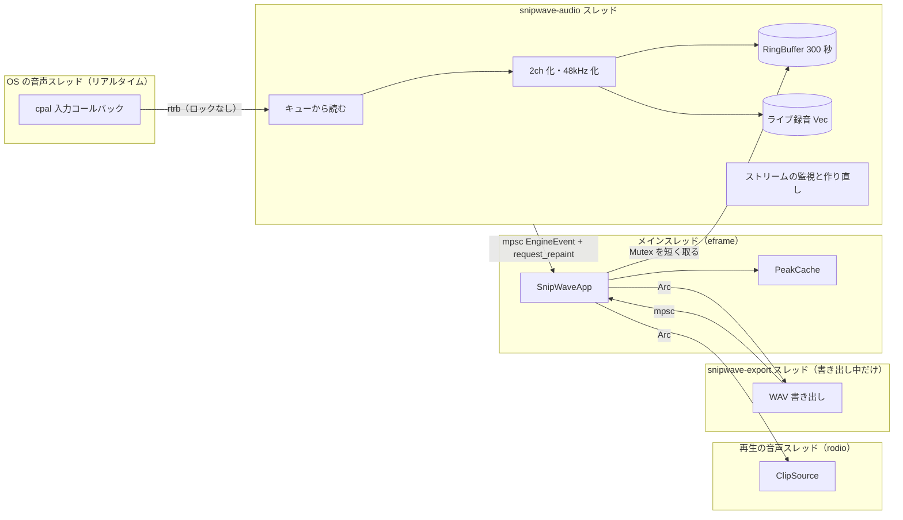
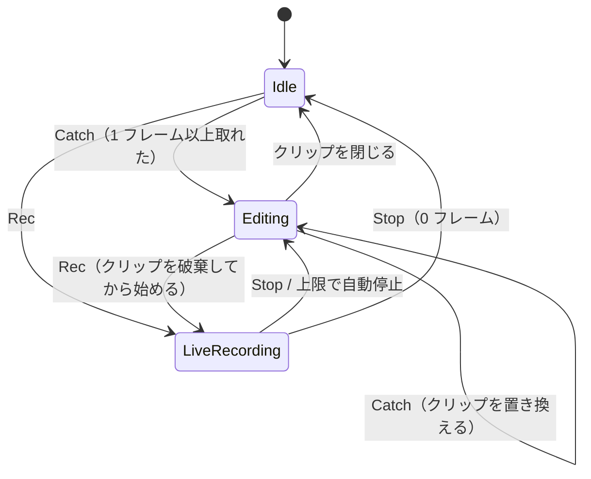

# SnipWave 詳細設計書（MVP v0.1）

- 対象の仕様: `docs/spec/SPEC.md`（MVP v0.1）、`docs/spec/ARCHITECTURE.md`
- 参考コード: `docs/spec/reference/`（そのまま使わない。§4.9 に扱いを書く）
- 調査日: 2026-11-25（クレートの版・対応状況はすべてこの日に確かめた値。出典は §2.4）
- 開発機: macOS 27.2（Apple Silicon）、rustc 1.93.0 / cargo 1.93.0
- 依頼者の了承: 2026-11-25（§12 の決定 14 件を含めて、この設計で実装に進む）

この設計書だけを読んで実装できるように書いてある。迷ったら、まず §13「実装者の決まり」と §10「タスク」を読む。

---

## 1. 目的と範囲

### 1.1 作るもの（MVP v0.1）

PC で鳴っている音（システム音声）を取り込み、波形で範囲を選んで WAV に書き出す、常駐型のデスクトップアプリ。

- 遡りキャプチャ（Catch）: 直前 N 秒（5〜300 秒、既定 30 秒）を取り込む
- ライブ録音（Rec / Stop）: 押してから止めるまでを取り込む
- 波形表示、ドラッグと数値入力での Start / End の指定、試聴（ループ再生あり）
- WAV 書き出し（48kHz / 2ch、24-bit int または 32-bit float）
- 設定の保存（遡り秒数、出力先、書き出し形式、ホットキー）
- トレイ常駐、グローバルホットキー
- macOS の `.app` バンドル（開発用。署名は ad-hoc）

### 1.2 作らないもの（v0.1 の範囲外）

- 波形の拡大・縮小、取り消し（Undo）、複数クリップの保持
- 取り込むデバイスやアプリの選択（常に「既定の出力デバイス」全体を取り込む）
- マイク入力、音量の正規化、フェード、MP3 などの圧縮形式
- ホットキーを画面から変える機能（`config.toml` を直接書き換える）
- ログイン時の自動起動、自動更新
- 配布用の署名・公証・インストーラ（開発用の ad-hoc 署名の `.app` まで）
- macOS 14.5 以前（§12-4 を参照）、ScreenCaptureKit での取得（代替案として §11 に残す）

### 1.3 仕様との対応表

| 仕様 | 内容 | 設計のどこで応えるか |
|---|---|---|
| 2 | 対応 OS・技術スタック | §2（クレート）、§3（macOS）、§8（CI） |
| 3.1-A | 遡りキャプチャ、300 秒の固定確保 | §4.4 `RingBuffer`、§4.6 `AudioEngine::snapshot_last`、§4.8 メモリ |
| 3.1-B | ライブ録音 | §4.6 `start_live` / `stop_live`、§4.7 状態遷移 |
| 3.2 | 波形表示・範囲指定・試聴 | §4.5 `PeakCache`、§5.3 波形、§4.6 `Player` |
| 3.3 | WAV 書き出し、ファイル名 | §4.6 `export`、§5.5 |
| 3.4 | 設定・永続化 | §4.6 `config`、§5.6 |
| 4 | CPU 1〜3% 以下、メモリ 150MB 以下 | §4.3 スレッド、§4.8 メモリ、§5.8 再描画、§12-6 |
| 4 | 免責事項 | §5.6（設定画面の下に表示）と README |

---

## 2. 依存クレート

### 2.1 ツールチェーンと egui の版（設計上の判断）

- **rustc は 1.93.0 に固定する**。`rust-toolchain.toml` に `channel = "1.93.0"`、`components = ["rustfmt", "clippy"]` を書く。`Cargo.toml` に `rust-version = "1.93"` と `resolver = "3"` を書く（resolver 3 は、手元の rustc で使えない版の依存を避けて選ぶ。Cargo 1.84 以上で使える）。`Cargo.lock` はコミットする。
- **eframe / egui は 0.35.0 にする**（仕様の 0.29 固定はやめる）。理由:
  - 最新は 0.37.0（2026-10-15）だが、0.36 以降は rustc 1.95 以上が必要。開発機の 1.93.0 で使える最新が 0.35.0（2026-06-25、必要 rustc 1.92）。
  - 0.35 の `eframe::App` には `logic()` がある。ウィンドウを隠している間も `Context::request_repaint()` で呼ばれるので、トレイに隠した状態でホットキーを処理できる（0.29 の `update()` だけでは隠れている間の動きが OS で変わる）。
  - 0.29.0（2024-09-26 公開）から 6 つ版が進んでおり、不具合修正を取り込める。
  - **注意**: 0.35 の `App` は `fn ui(&mut self, ui: &mut egui::Ui, frame: &mut eframe::Frame)`（必須）と `fn logic(&mut self, ctx: &egui::Context, frame: &mut eframe::Frame)`（任意）。参考コードや古い記事の `fn update(&mut self, ctx, frame)` ではない。
- 描画は **glow（OpenGL）** を使う。既定の wgpu より常駐時のメモリが少ないと見込むため（実測は T12。§4.8）。

### 2.2 選んだクレート

| 用途 | クレート | 版 | 公開日 | 必要 rustc | 補足 |
|---|---|---|---|---|---|
| GUI | `eframe` / `egui` | 0.35.0 | 2026-06-25 | 1.92 | `default-features = false`、features = `glow`, `default_fonts`, `x11`, `wayland`, `accesskit` |
| 音声の取得 | `cpal` | 0.18.2 | 2026-08-16 | 1.85 | 3 OS のループバックをこれ 1 つで扱う（§2.3）。Linux では features = `pipewire`, `pulseaudio` |
| 再生 | `rodio` | 0.23.0 | 2026-10-11 | 1.87 | `default-features = false`、features = `playback`。内部の cpal は 0.18.2 で一致 |
| コールバック→ワーカーの受け渡し | `rtrb` | 0.4.1 | 2026-10-25 | 1.38 | ロックなし・待ちなしの SPSC キュー |
| リサンプリング | `rubato` | 5.1.0 | 2026-11-12 | 1.87 | `Fft`（固定比）を使う。入出力は `audioadapter-buffers` 5.2.0 の `InterleavedSlice` |
| WAV 書き出し | `hound` | 3.5.1 | 2023-09-25 | 記載なし | 32-bit float と 24-bit int の両方を書ける |
| グローバルホットキー | `global-hotkey` | 0.10.0 | 2026-11-09 | 1.77 | Windows / macOS / Linux は **X11 のみ** |
| トレイ | `tray-icon` | 0.26.1 | 2026-10-07 | 1.90 | Linux は `default-features = false`、features = `ksni`（GTK のイベントループが要らない） |
| フォルダ選択 | `rfd` | 0.18.0 | 2026-11-07 | 1.92 | 既定の features（Linux は xdg-portal） |
| 設定の保存 | `serde` 1.0.229 / `toml` 1.2.2 / `directories` 6.0.0 | — | — | 1.85（toml） | 仕様の toml 0.8・directories 5.0 から上げる |
| 日時 | `chrono` | 0.4.45 | — | 1.62 | `default-features = false`、features = `clock` |
| エラー型 | `thiserror` | 2.0.21 | — | 1.77 | |
| ログ | `log` 0.4.35 / `env_logger` 0.11.12 | — | — | 1.85 | 標準エラーへ。画面の状態表示の代わりにはしない |
| Windows の exe アイコン | `winresource` | 0.1.34 | — | 記載なし | `[target.'cfg(windows)'.build-dependencies]` |
| テスト用 | `tempfile` | 3.27.0 | — | 1.63 | dev-dependency |
| macOS の自前の Tap（T7b） | `objc2` 0.6.5 / `objc2-core-audio` 0.3.2 / `objc2-core-foundation` 0.3.2 / `objc2-foundation` 0.3.2 / `libc` 0.2.191 | — | — | 1.71 | `[target.'cfg(target_os = "macos")'.dependencies]`。features は cpal 0.18.2 の `Cargo.toml` と同じ（`objc2-core-audio`: `std`, `AudioHardware`, `AudioHardwareDeprecated`, `objc2`, `objc2-foundation`、`objc2-foundation`: `std`, `NSArray`, `NSString`, `NSValue`、どちらも `default-features = false`）。`libc` は残骸の判定（`kill(pid, 0)`）に使う。1.0 は alpha なので 0.2 系にする。T2 で入れる |
| macOS の Dock からの再表示（§12-12） | `objc2-app-kit` | 0.3.2 | — | 1.71 | `[target.'cfg(target_os = "macos")'.dependencies]`、`default-features = false`。features は `std` と `NSApplication`・`NSResponder` を出発点にし、`NSApplicationDelegate` が使えるものを docs.rs の 0.3.2 で確かめて足す。T2 で入れる |
| Linux で X11 を指定する（§12-13） | `winit` | 0.30.13 | — | — | `[target.'cfg(target_os = "linux")'.dependencies]`、`default-features = false`、features = `x11`。eframe 0.35.0 が使う版と同じにする（`Cargo.lock` で 1 つにまとまることを確かめる）。`winit::platform::x11::EventLoopBuilderExtX11` を使うためだけに入れる。T2 で入れる |
| `.app` を作る道具 | `cargo-bundle` | 0.12.0 | 2026-09-20 | 記載なし | `cargo install` で入れる開発ツール（依存には足さない）。§3.3 |

採らなかったもの:

- `ringbuf` 0.6.0: `rtrb` と同じ用途。`rtrb` のほうが API が小さく、塊での読み書き（`write_chunk_uninit`）が素直。
- `wasapi` 0.27.0、`screencapturekit` 12.0.0、`pipewire` 0.10.1 を直接使う案: cpal が 3 OS とも対応したので使わない。代替案として §11 に残す。
- `cargo-packager` 0.11.8: 最後の公開が 2025-11-27 で 1 年止まっている。`cargo-bundle` は 2026-09 に更新があり、`Info.plist` への追記（`info_plist_exts`）に対応している。
- `anyhow`: アプリ内のエラーは `AppError`（§7）1 つにまとめるので使わない。

### 2.3 cpal 0.18.2 のループバック対応（ソースと CHANGELOG で確かめたこと）

| OS | 対応 | 使い方 | 確かめた場所 |
|---|---|---|---|
| Windows | あり | 出力デバイスで `build_input_stream` を呼ぶと `AUDCLNT_STREAMFLAGS_LOOPBACK` が付く | `src/host/wasapi/mod.rs` の Host の説明、`device.rs` 855 行付近 |
| macOS | あり（**14.6 以上**） | 入力を持たない出力デバイスで `build_input_stream` を呼ぶと、Process Tap と集約デバイスを作って取る | `src/host/coreaudio/macos/loopback.rs`、`device.rs` 727〜737 行、CHANGELOG 0.17.0「Support for loopback recording … on macOS > 14.6」、README「macOS 14.2 (loopback recording requires 14.6+)」 |
| Linux（PipeWire） | あり | `Audio/Sink` のデバイスは入力もできる扱い。入力ストリームを開くと `STREAM_CAPTURE_SINK` が付く | `src/host/pipewire/device.rs` 166〜169、910〜921 行。PipeWire ホストは 0.18.0 で追加 |
| Linux（PulseAudio） | モニターソース経由 | Sink では入力できない。`devices()` に出る Source のうち、既定 Sink の名前に `.monitor` を付けたものを開く | `src/host/pulseaudio/mod.rs` 168〜181、281 行。PulseAudio ホストは 0.18.0 で追加 |
| Linux（ALSA のみ） | なし | エラーを出す（§7） | — |

実装で必ず守ること（ソースを読んで分かった落とし穴）:

1. **cpal に 48kHz / 2ch を要求しない**。macOS の `build_input_stream` は、渡した設定で `set_physical_format` / `set_sample_rate` を呼ぶ（`device.rs` 714〜725 行）。ループバックでは対象が実際の出力デバイスなので、48kHz を要求すると利用者のデバイスのサンプルレートを書き換えてしまう。デバイスの既定の設定（`default_input_config()`、入力を持たなければ `default_output_config()`）のまま開き、48kHz / 2ch への変換は自分のワーカースレッドでする（§4.6）。
2. **macOS で、既定の出力デバイスが入力も持つ場合、cpal はループバックではなくそのデバイスの入力（マイク側）を録る**（`device.rs` 728 行の `if self.supports_input()`）。USB オーディオインターフェイスなどが当てはまる。扱いは §11 R1 と §12-5。
3. macOS の Tap は、作ったときの出力デバイスに結び付く。既定の出力デバイスが変わったら作り直す（§4.6 の監視）。
4. macOS の Tap は全プロセスの音を取る（`processes` が空で `exclusive = true`）。SnipWave 自身の試聴の音もリングバッファに入る。v0.1 ではそのままにする（設計上の判断）。
5. cpal 0.18 のシグネチャは `build_input_stream(config: StreamConfig, data_callback, error_callback, timeout: Option<Duration>)`。エラーは `cpal::Error` と `err.kind()`（`ErrorKind::DeviceNotAvailable` / `DeviceChanged` / `StreamInvalidated` / `Xrun` / `PermissionDenied` など）。

そのほか確かめた API の名前（実装の前に docs.rs の同じ版でもう一度見ること）:

- rtrb: `RingBuffer::new(capacity) -> (Producer, Consumer)`、`Producer::write_chunk_uninit(n)` → `fill_from_iter`、`Consumer::read_chunk(n)` → `as_slices()` → `commit_all()`、`slots()`
- rubato: `Fft::<f32>::new(rate_in, rate_out, chunk_size, channels, FixedSync::Input)`、`input_frames_next()`、`output_frames_max()`、`process_into_buffer(&in, &mut out, None)`
- rodio 0.23（名前が変わった直後。古い記事の `OutputStream` / `Sink` は無い）: `DeviceSinkBuilder::open_default_sink() -> MixerDeviceSink`、`Player::connect_new(sink.mixer())`、`Player::append(source)` / `stop()`。`Source` は `Iterator<Item = f32>` に `current_span_len()` / `channels() -> NonZero<u16>` / `sample_rate() -> NonZero<u32>` / `total_duration()` を足したもの
- global-hotkey: `GlobalHotKeyManager::new()`、`register(HotKey)`、`"Ctrl+Alt+C".parse::<HotKey>()`、`GlobalHotKeyEvent::set_event_handler(Some(f))`、`event.state == HotKeyState::Pressed`
- tray-icon: `TrayIconBuilder::new().with_menu(..).with_icon(..).with_tooltip(..).build()`、`Icon::from_rgba(rgba, w, h)`、`TrayIconEvent::set_event_handler`、`menu::MenuEvent::set_event_handler`
- eframe: `eframe::icon_data::from_png_bytes`、`ViewportBuilder::with_icon`、`ViewportCommand::{CancelClose, Visible(bool), Focus, Close}`、`ctx.input(|i| i.viewport().close_requested())`、`Context::request_repaint_after`
- rfd: `rfd::FileDialog::new().set_directory(..).pick_folder() -> Option<PathBuf>`
- hound: `WavSpec { channels, sample_rate, bits_per_sample, sample_format }`、`WavWriter::new(writer, spec)`、`write_sample`、`finalize`

### 2.4 出典（すべて 2026-11-25 に確認）

- 版・必要 rustc・features: `cargo info <crate>`（開発機、cargo 1.93.0）と crates.io API（`https://crates.io/api/v1/crates/<crate>`）
- cpal: `~/.cargo/registry/src/*/cpal-0.18.2/` のソース、`https://raw.githubusercontent.com/RustAudio/cpal/master/CHANGELOG.md`、同 `README.md`、同 `.github/workflows/platforms.yml`
- eframe: `eframe-0.35.0/src/epi.rs`（`App` トレイト）、`Cargo.toml`（features）
- rodio: `rodio-0.23.0/UPGRADE.md`、`src/stream.rs`、`src/player.rs`
- rubato: `rubato-5.1.0/README.md`、`src/synchro.rs`
- tray-icon / global-hotkey: 各クレートの `README.md`、`Cargo.toml`、`src/lib.rs`
- cargo-bundle: `cargo-bundle-0.12.0/README.md`
- Cargo の resolver: `https://doc.rust-lang.org/cargo/reference/resolver.html`
- Apple: `https://developer.apple.com/documentation/coreaudio/capturing-system-audio-with-core-audio-taps`、`https://developer.apple.com/documentation/bundleresources/information-property-list/nsaudiocaptureusagedescription`
- 権限まわりの実例: `https://github.com/insidegui/AudioCap`、`https://github.com/makeusabrew/audiotee`、`https://dev.to/nickdelv/2000-buffers-of-nothing-3i8`、`https://github.com/obsfx/audiograb`
- egui の CI で入れている Linux パッケージ: `https://raw.githubusercontent.com/emilk/egui/main/.github/workflows/rust.yml`

---

## 3. macOS の権限とパッケージ

### 3.1 分かっていること

- Process Tap で音を取るには、`Info.plist` に **`NSAudioCaptureUsageDescription`**（使用目的の文字列、macOS 14.2 以上）が要る。Apple の文書: 「To capture audio with a tap, you need to include the `NSAudioCaptureUsageDescription` key in your Info.plist file」「The first time you start recording from an aggregate device that contains a tap, the system prompts you to grant the app system audio recording permission」。
- 許可を事前に求める・調べる公開 API は無い（AudioCap の README）。許可のダイアログは、Tap を含むデバイスで録音を始めたときに出る。
- **許可が無いとき、エラーにならず、全部 0 のサンプルが届く**（dev.to の記事。エラーコードもログも出ない）。「音が取れている」は、サンプルの最大値が 0 より大きいことで確かめる。
- `Info.plist` を持てるのは `.app` バンドルだけ。したがって **macOS では `.app` にして動かす**。`cargo run` でターミナルから直接起動した場合、権限はターミナル側のアプリ（Terminal など）に付く扱いになり、ダイアログが出ないターミナルもある（audiotee の README）。

### 3.2 `Info.plist` に入れる値

`packaging/macos/Info.ext.plist`（`cargo-bundle` が `Info.plist` の `<dict>` の末尾にそのまま足す断片）:

```xml
<key>NSAudioCaptureUsageDescription</key>
<string>SnipWave は、PC で再生中の音声を取り込んで WAV に書き出すために、システムオーディオを録音します。</string>
```

- 最低バージョン（`LSMinimumSystemVersion` = 14.6）は、下の `minimum_system_version` で `cargo-bundle` が書く。断片には入れない（同じキーが 2 つになる）。

- バンドル ID: `com.snipwave.SnipWave`（設定フォルダの `ProjectDirs::from("com", "snipwave", "SnipWave")` と同じ並び。設計上の判断）
- サンドボックスは使わない。entitlements も足さない（開発用の ad-hoc 署名では不要）。

### 3.3 `.app` の作り方（`cargo-bundle` 0.12.0）

`Cargo.toml`（`cargo-bundle` は `[package]` の `description` も必須。`description = "System audio sampler: catch the last seconds, trim, export WAV"` を入れる）:

```toml
[package.metadata.bundle]
name = "SnipWave"
identifier = "com.snipwave.SnipWave"
icon = ["assets/icons/macos/icon.icns"]
category = "public.app-category.music"
short_description = "System audio sampler"

[package.metadata.bundle.osx]
minimum_system_version = "14.6"
info_plist_exts = ["packaging/macos/Info.ext.plist"]
```

開発ビルドを動かす手順（`scripts/macos/dev-app.sh` にまとめる）:

```sh
cargo install cargo-bundle --version 0.12.0 --locked   # 初回だけ
cargo bundle                                            # target/debug/bundle/osx/SnipWave.app
plutil -p target/debug/bundle/osx/SnipWave.app/Contents/Info.plist | grep NSAudioCapture   # キーが入ったか確かめる
codesign --force --deep --sign - target/debug/bundle/osx/SnipWave.app                      # ad-hoc 署名
open target/debug/bundle/osx/SnipWave.app
```

- 初回、取得を始めたところで許可のダイアログが出る。「許可」を押す。あとから変える場所は、システム設定 → プライバシーとセキュリティ →（画面収録とシステムオーディオ録音の項目の中の）「システムオーディオ録音のみ」。項目の日本語の表記は T1 で実機の表示を見て README に書く。
- やり直すとき: `tccutil reset All com.snipwave.SnipWave`
- 標準エラーのログを見るとき: `target/debug/bundle/osx/SnipWave.app/Contents/MacOS/snipwave` を直接起動する（この場合の権限の付き先は T1 で確かめる）。
- 画面だけを触る作業（音が要らない）は `cargo run` でよい。

T1 で確かめて、この節と README に結果を書き足すこと: ad-hoc 署名のまま作り直したときに許可が残るか。残らないなら、キーチェーンで自己署名のコード署名証明書（例: 「SnipWave Dev」）を作り、`--sign "SnipWave Dev"` に変える。

---

## 4. 構成

### 4.1 ファイル一覧

```
Cargo.toml / Cargo.lock / rust-toolchain.toml / clippy.toml / build.rs（Windows の exe アイコン）/ .gitignore
.github/workflows/ci.yml
packaging/macos/Info.ext.plist
scripts/macos/dev-app.sh          # .app を作って ad-hoc 署名して開く
scripts/macos/probe-app.sh        # T1 の検証用 .app を手で組む
scripts/gen-icons.sh              # SVG から各 OS のアイコンを作る
assets/icons/…                    # 生成物（コミットする。§6）
assets/fonts/NotoSansJP-Regular.ttf + OFL.txt
examples/loopback_probe.rs        # T1 の検証（残しておく。取得の切り分けに使う）
examples/playback_probe.rs        # T8 の検証（試聴とループ）
examples/tap_probe.rs             # T1b の検証（macOS 専用。CI の clippy --all-targets が 3 OS で通るよう、
                                  #   macOS 以外では「macOS 専用です」と出して終わる main を cfg で用意する）
src/
  lib.rs             # モジュールの宣言だけ（pub mod audio; pub mod config; …）。examples とテストから使うため
  main.rs            # 起動だけ: ログ、設定の読み込み、AudioEngine の開始、eframe の起動（snipwave:: 経由で使う）
  error.rs           # AppError、Status（§7）
  config.rs          # AppConfig、読み書き
  export.rs          # WAV 書き出し、ファイル名
  hotkeys.rs         # グローバルホットキーの登録とイベント
  tray.rs            # トレイのアイコンとメニュー
  macos_reopen.rs    # macOS だけ。Dock のアイコンを押したらウィンドウを戻す（§5.7、§12-12）
  audio/
    mod.rs           # 定数（SAMPLE_RATE など）と再公開
    ring.rs          # RingBuffer（300 秒の循環バッファ）
    clip.rs          # CapturedClip（取り込んだ音声）
    convert.rs       # チャンネル変換、リサンプラ（rubato）
    capture.rs       # cpal でループバックを開く（OS ごとの違いはここだけ）
    capture_macos_tap.rs  # macOS の入出力一体デバイス用の自前の Tap（T7b、§12-5）
    engine.rs        # AudioEngine（ワーカースレッド、Catch / Rec、状態）
    peaks.rs         # PeakCache（波形の最小・最大）
    playback.rs      # Player（試聴、ループ）
  ui/
    mod.rs
    app.rs           # SnipWaveApp（eframe::App）、AppState、イベントの振り分け
    state.rs         # 状態遷移の純粋な関数（§4.7）
    theme.rs         # 配色トークン、Visuals、フォント
    text.rs          # 画面に出す文言（1 か所にまとめる）
    header.rs        # ヘッダー（取得の状態、レベルメーター、設定ボタン）
    controls.rs      # Catch / Rec / 遡り秒数
    waveform.rs      # 波形の描画と範囲選択
    edit_bar.rs      # Start / End、試聴、書き出し
    settings.rs      # 設定パネル
    status_bar.rs    # 状態表示とエラーの履歴
```

クレートは「ライブラリ（`src/lib.rs`）＋薄いバイナリ（`src/main.rs`）」にする。`examples/` の検証用プログラムが `snipwave::audio::engine::AudioEngine` などを使えるようにするため（設計上の判断）。テストは各ファイルの `#[cfg(test)] mod tests` に書く。

### 4.2 定数（`src/audio/mod.rs`）

```rust
pub const SAMPLE_RATE: u32 = 48_000;
pub const CHANNELS: usize = 2;
pub const MIN_BUFFER_SECONDS: u32 = 5;
pub const MAX_BUFFER_SECONDS: u32 = 300;
pub const DEFAULT_BUFFER_SECONDS: u32 = 30;
pub const RING_CAPACITY_FRAMES: usize = (SAMPLE_RATE * MAX_BUFFER_SECONDS) as usize; // 14_400_000
pub const LIVE_MAX_SECONDS: u32 = 600;          // ライブ録音の上限（§12-7）
pub const HANDOFF_SECONDS: u32 = 2;             // コールバック→ワーカーのキューの長さ
pub const MIN_SELECTION_FRAMES: usize = 480;    // 選択の最小の長さ（10 ミリ秒）
```

用語: **フレーム** = 左右 1 組。**サンプル** = f32 1 個。バッファは常に左右を交互に並べた（インターリーブ）f32。

### 4.3 スレッド



| スレッド | 作る側 | すること | してはいけないこと |
|---|---|---|---|
| OS の音声スレッド | cpal | 届いたサンプルを 2ch の f32 にして `rtrb` に書く。空きが足りなければその塊を捨て、捨てたフレーム数をアトミックに足す | ロック、メモリ確保、ログ出力、リサンプリング、チャンネル送信 |
| `snipwave-audio` | `AudioEngine::start` | cpal のストリームを作って持つ。10 ミリ秒ごとにキューを読み、48kHz に変換して `RingBuffer` とライブ録音に書く。レベルを計算する。約 1 秒ごとに既定の出力デバイスが変わっていないかを見て、変わったら・エラーが来たら作り直す | UI を待つこと |
| メイン（UI） | eframe | 描画、操作、ホットキーとトレイのイベント、スナップショットの取得、フォルダ選択 | 長い処理（書き出しは別スレッド） |
| 再生 | rodio | `ClipSource::next()` を呼ぶ。アトミックだけを読む | ロック |
| `snipwave-export` | 書き出しのたび | WAV を書いて結果を `mpsc` で返す | — |

- cpal の `Stream` は `snipwave-audio` スレッドの中で作り、そこで保持し、そこで破棄する（OS によって `Send` でないことがあるため）。
- トレイとホットキーのマネージャは、メインスレッドで、eframe のアプリ生成クロージャ（`run_native` の第 3 引数）の中で作る（macOS と Windows の制約。§2.3 の README）。

### 4.4 `audio/ring.rs`

```rust
/// 300 秒ぶんを起動時に 1 回だけ確保する循環バッファ。確保し直さない。
pub struct RingBuffer {
    data: Vec<f32>,            // 長さ = capacity_frames * CHANNELS、最初から 0 で埋める
    write_frame: usize,        // 次に書く位置（フレーム）
    filled_frames: usize,      // 書いた量（capacity で頭打ち）
}

impl RingBuffer {
    pub fn new(capacity_frames: usize) -> Self;
    pub fn capacity_frames(&self) -> usize;
    pub fn filled_frames(&self) -> usize;
    /// インターリーブのサンプルを足す。古いものから上書きする。長さは CHANNELS の倍数。
    pub fn push_interleaved(&mut self, samples: &[f32]);
    /// 末尾から `frames` ぶんを、古い順に `out` へ写す。持っている量が少なければその量だけ。
    /// 写したフレーム数を返す。`out` は空にしてから書く。
    pub fn copy_latest(&self, frames: usize, out: &mut Vec<f32>) -> usize;
}
```

- `push_interleaved` は `copy_from_slice` を最大 2 回（末尾で折り返すとき）。1 サンプルずつの `pop_front` はしない。
- 設定の遡り秒数を変えても `RingBuffer` には触らない（取り出す長さが変わるだけ）。

### 4.5 `audio/clip.rs`、`audio/peaks.rs`

```rust
/// 取り込んだ音声。48kHz / 2ch / f32 のインターリーブ。作ったあとは変えない。
pub struct CapturedClip {
    pub id: u64,                    // 取り込みごとに 1 ずつ増える（キャッシュの鍵）
    pub samples: Vec<f32>,
    pub source: ClipSourceKind,     // Catch | Live
    pub captured_at: chrono::DateTime<chrono::Local>,
}
pub enum ClipSourceKind { Catch, Live }

impl CapturedClip {
    pub fn frames(&self) -> usize;              // samples.len() / CHANNELS
    pub fn duration_secs(&self) -> f64;
}
// 共有は Arc<CapturedClip>。試聴と書き出しは Arc を持つだけで、複製しない。

/// 波形用。256 フレームごとの最小・最大（左右の平均）を、取り込み時に 1 回だけ作る。
pub struct PeakCache { /* blocks: Vec<(f32, f32)>、clip_id */ }

impl PeakCache {
    pub const BLOCK_FRAMES: usize = 256;
    pub fn build(clip: &CapturedClip) -> Self;
    /// クリップ全体を `width_px` 本の列に分け、列ごとの (最小, 最大) を返す。
    /// 1 列が BLOCK_FRAMES より短いときは、クリップのサンプルを直接見る。
    pub fn columns(&self, clip: &CapturedClip, width_px: usize) -> Vec<(f32, f32)>;
}
```

### 4.6 そのほかのモジュールの公開 API

**`audio/convert.rs`**

```rust
/// 任意のチャンネル数のインターリーブを 2ch にする反復子を返す（確保なし。コールバックで使う）。
/// 1ch → 左右に同じ値。2ch 以上 → 先頭の 2 チャンネル（Front L / R）を使い、残りは捨てる。
pub fn to_stereo<'a, T>(input: &'a [T], channels: usize) -> impl Iterator<Item = f32> + 'a
where T: cpal::Sample, f32: cpal::FromSample<T>;

/// デバイスのレート → 48kHz。レートが同じなら素通し。
pub struct StereoResampler { /* rubato::Fft<f32>、入出力の作業バッファ、端数の持ち越し */ }

impl StereoResampler {
    pub fn new(input_rate: u32) -> Result<Self, AppError>;
    /// 2ch インターリーブを受け取り、48kHz に変換したぶんを `out` の末尾に足す。
    /// 塊に満たない端数は中に持ち越す。
    pub fn process(&mut self, input: &[f32], out: &mut Vec<f32>) -> Result<(), AppError>;
}
```

**`audio/capture.rs`**

```rust
pub struct OpenedCapture {
    pub stream: cpal::Stream,                 // このスレッドで保持する
    pub consumer: rtrb::Consumer<f32>,        // 2ch、デバイスのレート
    pub device_rate: u32,
    pub device_name: String,
    pub device_id: String,                    // 既定デバイスが変わったかの比較に使う
    #[cfg(target_os = "macos")]
    pub tap: Option<TapAggregate>,            // 自前の Tap を使ったときだけ Some。stream より後に捨てる
}

/// 既定の出力デバイスのループバックを開いて再生（play）まで行う。
/// `dropped_frames` と `stream_error` は、コールバックから書くためのアトミック。
pub fn open_loopback(
    dropped_frames: Arc<AtomicU64>,
    stream_error: Arc<AtomicBool>,
) -> Result<OpenedCapture, AppError>;

/// いまの既定の出力デバイスの ID（作り直しの判断に使う）。
pub fn current_default_output_id() -> Result<String, AppError>;
```

**`audio/capture_macos_tap.rs`**（macOS だけ。`audio/mod.rs` で `#[cfg(target_os = "macos")] mod capture_macos_tap;`。T2 で下のシグネチャだけの骨組みを作り、T7b で中身を書く。T1b の `examples/tap_probe.rs` の手順を移す）

```rust
/// 自前の Process Tap と、それを含む集約デバイス。捨てると両方を破棄する。
pub struct TapAggregate { /* Tap と集約デバイスの AudioObjectID、集約デバイスの名前 */ }

impl TapAggregate {
    /// 既定の出力デバイスを対象に、全プロセスの Tap（ミュートしない）と、
    /// それを入れた集約デバイス `SnipWave Loopback <pid>` を作る。非公開（`kAudioAggregateDeviceIsPrivateKey` = YES）で作り、
    /// cpal の `devices()` に出なければ公開で作り直す（どちらにするかは T1b の結果で決めて固定する。§12-14）。
    pub fn create_for_default_output() -> Result<Self, AppError>;
    /// cpal の `host.devices()` から探すときの名前。
    pub fn device_name(&self) -> &str;
}

impl Drop for TapAggregate { /* 集約デバイス → Tap の順に破棄する。失敗は log に出す */ }

/// 前回の残骸（名前が `SnipWave Loopback` で始まる集約デバイス）を破棄し、破棄した数を返す。起動時に 1 回呼ぶ。
pub fn destroy_stale_aggregates() -> Result<usize, AppError>;
```

`open_loopback` の手順:

1. `host = cpal::default_host()`（Linux は features により PipeWire → PulseAudio → ALSA の順）。
2. `device = host.default_output_device()`。無ければ `AppError::NoOutputDevice`。
3. ホストごとの分岐:
   - PulseAudio: `host.devices()` から、ID が「既定 Sink の名前 + `.monitor`」に当たる Source を探して、それを `device` にする。見つからなければ `AppError::LoopbackUnsupported`。
   - ALSA: `AppError::LoopbackUnsupported`（「PipeWire か PulseAudio が必要です」）。
   - macOS: `device.supports_input()` が真なら、cpal のループバックは使えない（マイク側を録る）。自前の Tap（`capture_macos_tap.rs`、T7b）で集約デバイスを作り、それを `device` にする（§12-5 の決定で v0.1 に入れる）。T7 の時点では、この分岐は `AppError::LoopbackUnsupported`（「この出力デバイスは入力も持つため、取り込めません」）を返しておき、T7b で差し替える。Tap の作成に失敗したときも `AppError::LoopbackUnsupported` に理由を付けて返す。
4. `config = if device.supports_input() { device.default_input_config() } else { device.default_output_config() }`。**レートとチャンネル数はこの値のまま使う**。
5. `rtrb::RingBuffer::new(config.sample_rate * 2 * HANDOFF_SECONDS)`。
6. `config.sample_format()` で分岐して `build_input_stream::<T, _, _>` を呼ぶ（F32 / I16 / I32 / U16。ほかは `AppError::UnsupportedFormat`）。コールバックの中身は「`to_stereo` → `write_chunk_uninit` → `fill_from_iter`。空きが足りなければ `dropped_frames.fetch_add`」だけ。エラーコールバックは `stream_error.store(true)` だけ（ログも出さない。内容は作り直しのときのエラーで分かる）。
7. `stream.play()`。

**`audio/engine.rs`**

```rust
#[derive(Clone, Debug, PartialEq)]
pub enum CaptureStatus {
    Starting,
    Running { device_name: String, device_rate: u32 },
    Failed { message: String },     // 作り直しを続けている間もこの表示
}

pub enum EngineEvent {
    CaptureStarted { device_name: String, device_rate: u32 },
    CaptureFailed(AppError),
    LiveAutoStopped,                // 上限に達して自動で止めた
    FramesDropped(u64),             // 前回の通知からの増分
    SilentSinceStart,               // 開始から 5 秒、全サンプルが 0（macOS の権限の案内に使う）
}

pub struct AudioEngine { /* Arc<Shared>、ワーカーの JoinHandle、mpsc::Receiver<EngineEvent> */ }

impl AudioEngine {
    /// 300 秒ぶんを確保し、snipwave-audio スレッドを始める。
    /// `wake` は、イベントを送ったあとに呼ぶ（UI の `ctx.request_repaint()` を渡す）。
    pub fn start(wake: Arc<dyn Fn() + Send + Sync>) -> Result<Self, AppError>;

    /// 直前 `seconds` 秒を取り込む。持っている量が少なければその量。0 フレームなら AppError::NoAudioYet。
    pub fn snapshot_last(&self, seconds: u32) -> Result<CapturedClip, AppError>;

    pub fn start_live(&self) -> Result<(), AppError>;          // すでに録音中なら AppError::Internal
    pub fn stop_live(&self) -> Result<CapturedClip, AppError>; // 0 フレームなら AppError::NoAudioYet
    pub fn is_live(&self) -> bool;
    pub fn live_frames(&self) -> u64;                          // 経過時間の表示用

    pub fn status(&self) -> CaptureStatus;
    pub fn peak_levels(&self) -> [f32; 2];                     // 直近の塊の最大値（0.0〜）
    pub fn dropped_frames(&self) -> u64;
    pub fn drain_events(&self) -> Vec<EngineEvent>;
    pub fn shutdown(self);                                     // ワーカーを止めて join する
}
```

共有する中身（`Shared`）:

```rust
struct Store { ring: RingBuffer, live: Option<Vec<f32>> }   // Mutex<Store>
// ほか: status: Mutex<CaptureStatus>、peak_l / peak_r: AtomicU32（f32 のビット）、
//       dropped_frames: AtomicU64、live_frames: AtomicU64、shutdown: AtomicBool
```

- `Mutex<Store>` を取るのは `snipwave-audio`（10 ミリ秒ごとに、書く間だけ）と UI（Catch・Rec・Stop のとき）。**音声コールバックは取らない**。
- UI が 300 秒ぶんを写している間（数十ミリ秒）ワーカーは待つが、その間の音は `rtrb`（2 秒ぶん）に溜まるので欠けない。
- ライブ録音の `Vec` は `Vec::with_capacity(60 秒ぶん)` で始め、足りなければ伸びる（伸ばすのはワーカースレッドなので、コールバックには影響しない）。`LIVE_MAX_SECONDS` に達したら、ワーカーが録音を止めて `Store` に置いたままにし、`EngineEvent::LiveAutoStopped` を送る。UI はそれを受けて `stop_live()` を呼ぶ。
- ロックが壊れている（poisoned）ときは `AppError::Internal` を返す。握りつぶさない。

ワーカーのループ（疑似コード）:

```
loop {
  if shutdown { break }
  if 取得していない { open_loopback を試す。失敗なら status = Failed、CaptureFailed を 1 回だけ送り、2 秒待って次の周へ }
  キューにあるぶんを読む → resampler.process → Store をロックして ring と live に書く → レベルを更新
  約 1 秒ごと: stream_error が立っている、または current_default_output_id() が変わった → ストリームを捨てて「取得していない」に戻す
  開始から 5 秒、最大値がずっと 0 → SilentSinceStart を 1 回だけ送る
  dropped_frames が増えていたら FramesDropped を送る（1 秒に 1 回まで）
  10 ミリ秒眠る
}
```

**`audio/playback.rs`**

```rust
/// 試聴。選択範囲 [start, end) を鳴らす。範囲とループは再生中でも変えられる。
pub struct Player { /* Option<rodio::MixerDeviceSink>、Option<rodio::Player>、Arc<PlaybackShared> */ }

impl Player {
    pub fn new() -> Self;                                   // 出力はまだ開かない
    /// 出力を開いて（初回だけ）再生を始める。再生中なら頭から鳴らし直す。
    pub fn play(&mut self, clip: Arc<CapturedClip>, start_frame: usize, end_frame: usize, looping: bool)
        -> Result<(), AppError>;
    pub fn stop(&mut self);                                 // 出力も閉じる（待機時の CPU を増やさない）
    pub fn set_range(&self, start_frame: usize, end_frame: usize);
    pub fn set_looping(&self, looping: bool);
    pub fn is_playing(&self) -> bool;                       // ループなしで末尾まで来たら false
    pub fn position_frame(&self) -> usize;                  // 再生位置の線に使う
}

/// rodio::Source の実装。start / end / looping / position / finished はアトミック。
/// 位置が範囲の外に出たら start に戻る（ループなしで end に達したら終わる）。
struct ClipSource { /* clip: Arc<CapturedClip>、shared: Arc<PlaybackShared>、次に返すチャンネル */ }
```

出力デバイスが 48kHz / 2ch でないときの変換は rodio に任せる。

**`export.rs`**

```rust
#[derive(Clone, Copy, Debug, PartialEq, Eq, serde::Serialize, serde::Deserialize)]
#[serde(rename_all = "lowercase")]
pub enum ExportFormat { Int24, Float32 }          // config.toml では "int24" / "float32"

pub struct ExportRequest {
    pub clip: Arc<CapturedClip>,
    pub start_frame: usize,
    pub end_frame: usize,                          // この位置は含まない
    pub format: ExportFormat,
    pub output_dir: PathBuf,
    pub now: chrono::DateTime<chrono::Local>,
}
pub struct ExportOutcome { pub path: PathBuf, pub frames: usize, pub clipped_samples: usize }

/// 書き出す。出力先が無ければ作る。`<名前>.part` に書いてから名前を変える（途中で失敗したら .part を消す）。
pub fn export_wav(req: &ExportRequest) -> Result<ExportOutcome, AppError>;

/// `snip_YYYYMMDD_HHMMSS.wav`。同じ名前があれば `snip_YYYYMMDD_HHMMSS_2.wav`、`_3` … とする。
pub fn unique_output_path(dir: &Path, now: chrono::DateTime<chrono::Local>) -> PathBuf;

/// f32 → 24-bit。[-1.0, 1.0] に切り詰めてから 8_388_607 を掛けて四捨五入する。ディザはかけない。
pub fn f32_to_i24(sample: f32) -> i32;
```

- 範囲の外れ（`start >= end`、`end > frames`）は `AppError::InvalidSelection`。
- 24-bit で切り詰めたサンプルがあれば、その数を `clipped_samples` で返し、画面に注意として出す。

**`config.rs`**

```rust
#[derive(Clone, Debug, PartialEq, serde::Serialize, serde::Deserialize)]
#[serde(default)]
pub struct AppConfig {
    pub buffer_seconds: u32,        // 5〜300、既定 30
    pub output_dir: PathBuf,        // 既定: OS のミュージックフォルダ
    pub export_format: ExportFormat,// 既定: Int24（§12-3）
    pub hotkey_catch: String,       // 既定 "Ctrl+Alt+C"（§12-2）。空文字なら登録しない
    pub hotkey_rec: String,         // 既定 "Ctrl+Alt+R"
}

pub struct LoadedConfig { pub config: AppConfig, pub warnings: Vec<String> }

impl AppConfig {
    pub fn config_path() -> Result<PathBuf, AppError>;    // ProjectDirs("com","snipwave","SnipWave").config_dir()/config.toml
    pub fn load() -> Result<LoadedConfig, AppError>;      // 下の load_from を呼ぶ
    pub fn load_from(path: &Path) -> Result<LoadedConfig, AppError>;
    pub fn save(&self) -> Result<(), AppError>;
    pub fn save_to(&self, path: &Path) -> Result<(), AppError>;   // 一時ファイルに書いてから名前を変える
    pub fn validated(self) -> (AppConfig, Vec<String>);   // 範囲外を丸め、丸めた内容を返す
}
```

- ファイルが無い: 既定値で始める（警告なし）。最初の保存で作る。
- 読めない・TOML として壊れている: ファイルを `config.toml.bad` に名前を変えて残し、既定値で始め、`warnings` に入れて画面に出す。
- `buffer_seconds` が範囲外: 5〜300 に丸め、`warnings` に入れる。
- 既定の出力先: `directories::UserDirs::new().audio_dir()` → 無ければホーム → それも無ければ `AppError::Config`。
- 保存のタイミング: 値が変わったとき。スライダーはドラッグを離したとき（`response.drag_stopped()`）と、キー入力で変わったとき。

**`hotkeys.rs`**

```rust
#[derive(Clone, Copy, Debug, PartialEq, Eq)]
pub enum HotkeyAction { Catch, ToggleRec }

pub struct Hotkeys { /* GlobalHotKeyManager、id → HotkeyAction の対応 */ }

impl Hotkeys {
    /// 2 つを登録する。片方が失敗しても、もう片方は登録する。
    /// 失敗（文字列が読めない、ほかのアプリが使っている、Wayland など）は Vec で返す。
    /// 押された（Pressed）ときだけ `on_action` を呼ぶ。`on_action` の中では送信と request_repaint だけをする。
    pub fn register(
        config: &AppConfig,
        on_action: impl Fn(HotkeyAction) + Send + Sync + 'static,
    ) -> (Option<Self>, Vec<AppError>);
}
```

**`tray.rs`**

```rust
#[derive(Clone, Copy, Debug, PartialEq, Eq)]
pub enum TrayAction { ShowWindow, Catch, ToggleRec, Quit }

pub struct Tray { /* tray_icon::TrayIcon、メニュー項目 */ }

impl Tray {
    /// メニュー: 「ウィンドウを表示」「Catch（直前 N 秒）」「Rec 開始 / 停止」「終了」。
    /// アイコンの左クリックは ShowWindow。
    pub fn create(on_action: impl Fn(TrayAction) + Send + Sync + 'static) -> Result<Self, AppError>;
    pub fn set_recording(&self, recording: bool) -> Result<(), AppError>;      // メニューの文言とツールチップを変える
    pub fn set_buffer_seconds(&self, seconds: u32) -> Result<(), AppError>;
}
```

**`macos_reopen.rs`**（macOS だけ。`lib.rs` で `#[cfg(target_os = "macos")] pub mod macos_reopen;`）

```rust
/// 自前の NSApplicationDelegate（`applicationShouldHandleReopen:hasVisibleWindows:` だけを持つ）を登録する。
/// Dock のアイコンが押されたら `on_reopen` を呼ぶ（呼ばれた側は AppAction の ShowWindow を送る）。
/// winit は自分ではデリゲートを登録しないと保証している（winit 0.30.13 の `src/platform/macos.rs` の説明）。
/// `NSApplication::sharedApplication` は eframe のイベントループができたあと（アプリ生成のクロージャの中）で呼ぶ。
/// 戻り値のデリゲートは、アプリが生きている間持っておく（捨てると登録が外れる）。
/// winit の説明の例は objc2 0.5 の `declare_class!` だが、0.6 では `define_class!` に変わっている。docs.rs の 0.6.5 で確かめて書く。
pub fn install(on_reopen: impl Fn() + 'static) -> Result<ReopenDelegate, AppError>;
pub struct ReopenDelegate { /* Retained<自前のデリゲート> */ }
```

**`ui/app.rs`**

```rust
pub struct SnipWaveApp { /* config、engine、player、tray: Option<Tray>、hotkeys: Option<Hotkeys>、
                            state、clip: Option<Arc<CapturedClip>>、peaks、selection、status、
                            actions: mpsc::Receiver<AppAction>、export_rx、quitting: bool … */ }

pub enum AppAction { Hotkey(HotkeyAction), Tray(TrayAction) }

impl SnipWaveApp {
    pub fn new(cc: &eframe::CreationContext<'_>, loaded: LoadedConfig, engine: AudioEngine) -> Self;
}
impl eframe::App for SnipWaveApp {
    fn logic(&mut self, ctx: &egui::Context, frame: &mut eframe::Frame);   // イベントの処理（隠れていても動く）
    fn ui(&mut self, ui: &mut egui::Ui, frame: &mut eframe::Frame);        // 描画だけ
}
```

`logic()` ですること（順に）: `AppAction` を受け取って処理 → `engine.drain_events()` → 書き出しの結果 → 自動停止 → 閉じる要求（§5.7）→ 次の再描画の予約（§5.8）。操作ボタンも同じ関数（`do_catch()` / `do_toggle_rec()` など）を呼ぶ。入口が違っても処理は 1 つ。

### 4.7 状態遷移（`ui/state.rs`）

```rust
#[derive(Clone, Copy, Debug, PartialEq, Eq)]
pub enum AppState { Idle, LiveRecording, Editing }

#[derive(Clone, Copy, Debug, PartialEq, Eq)]
pub enum AppEvent { Catch, RecStart, RecStop, LiveAutoStopped, CloseClip, CaptureYieldedNothing }

/// 遷移できないときは None（呼び出し側は状態表示に理由を出す）。副作用は持たない。
pub fn next_state(state: AppState, event: AppEvent) -> Option<AppState>;
```



- `LiveRecording` 中の Catch は受け付けない（ボタンは無効。ホットキーなら「録音中は Catch できません」と出す）。
- どの状態でも、裏のリングバッファへの書き込みは続く。
- 取得の失敗（`CaptureStatus::Failed`）は `AppState` とは別に持つ。`LiveRecording` 中に失敗しても、そこまでの録音は残り、Stop で取り込める。
- クリップを置き換える・破棄するときは、**先に** 試聴を止めて古い `Arc<CapturedClip>` を手放してから、新しい取り込みをする（メモリを 3 重に持たない）。
- 試聴（止まっている / 再生中）と書き出し（していない / 書き出し中）は、`Editing` の中の別の状態として `Player` と `export_rx` で持つ。書き出し中は書き出しボタンを無効にする。

### 4.8 メモリ

| 中身 | 大きさ | いつ |
|---|---|---|
| リングバッファ（48,000 × 2ch × 4 バイト × 300 秒） | 115.2 MB | 起動時に確保。書かれたページから実メモリになり、起動から 5 分で全部が実メモリになる |
| 受け渡しのキュー（2 秒） | 0.8 MB（48kHz のとき） | 取得中 |
| 取り込んだクリップ（Catch） | 設定の秒数ぶん。30 秒で 11.5 MB、300 秒で 115.2 MB | `Editing` の間 |
| 取り込んだクリップ（Rec） | 1 分あたり 23 MB、上限 10 分で 230 MB | `Editing` の間 |
| 波形のキャッシュ | 300 秒で約 0.45 MB | `Editing` の間 |
| GUI（eframe + glow、フォント） | T12 で測る | 常に |

- スナップショットは、リングバッファから新しい `Vec<f32>` へ **複製する**（リングバッファは書き続けるので、共有はできない）。300 秒を取り込むと、リングバッファと合わせて約 230 MB になる。試聴と書き出しは `Arc` で同じ中身を見るので、それ以上は増えない。クリップを閉じるか次の取り込みをすると、前のぶんは解放される。
- **仕様の「待機時 150MB 以下」との関係**: リングバッファだけで 115.2 MB を使うので、GUI に残るのは約 35 MB。`Idle`（クリップなし、ウィンドウを隠した状態）で 150 MB に収まるかは、作って測らないと分からない。この設計では「待機時 = `Idle`」と読み、`Editing` 中の増加は目標の対象外とする。収まらなかったときの扱いは §12-6。
- 測り方（T12）: `.app` を起動して 6 分以上音を流し、ウィンドウを隠した状態で、アクティビティモニタの「メモリ」（実メモリ）と CPU を読む。

### 4.9 参考コードの扱い

| 参考コード | この設計での扱い |
|---|---|
| `audio/buffer.rs` の `AudioRecorderEngine`（`Arc<Mutex<VecDeque>>` を 1 サンプルずつ） | 使わない。`RingBuffer` + `AudioEngine` に置き換える |
| 名前の食い違い（`snapshot` / `catch_retroactive`、`start_live_rec` / `start_live_recording`） | `snapshot_last` / `start_live` / `stop_live` に統一する |
| `config.rs` の `let _ =`、`if let Ok` | すべて `Result` で返し、画面に出す（§7） |
| `ui/app.rs` の `update()`、0.0〜1.0 の `trim_start` / `trim_end` | `logic()` + `ui()`。選択範囲はフレーム番号（`usize`）で持つ |
| `Cargo.toml` の版 | §2.2 の版に置き換える |

---

## 5. 画面

### 5.1 レイアウト

ウィンドウ: 既定 960 × 560、最小 760 × 440、タイトル「SnipWave」。

```
┌────────────────────────────────────────────────────────────────────────────┐
│ [mark] SnipWave      ● 取得中  MacBook Pro のスピーカー・48 kHz    L ▮▮▮▮▯▯  [設定] │ ヘッダー 48
│                                                                R ▮▮▮▯▯▯        │
├────────────────────────────────────────────────────────────────────────────┤
│ ┌────────────────┐ ┌──────────┐                                            │
│ │ ◀◀ Catch 30 秒 │ │ ● Rec    │      遡り秒数  ├────●──────────┤  30 秒     │ 操作 72
│ └────────────────┘ └──────────┘      （Ctrl+Alt+C / Ctrl+Alt+R）            │
├────────────────────────────────────────────────────────────────────────────┤
│ 0:00        0:05        0:10        0:15        0:20        0:25      0:30 │ 目盛り 20
│ ░░░░░░░░░┃▓▓▓▓▓▓▓▓▓▓▓▓▓▓▓▓│▓▓▓▓▓▓▓▓▓▓▓▓▓▓┃░░░░░░░░░░░░░░░░░░░░░░░░░░░░░░░ │
│ ░░ 波形 ░┃▓▓▓ 選択範囲 ▓▓▓│▓▓▓▓▓▓▓▓▓▓▓▓▓▓┃░░░░░░░░░░░░░░░░░░░░░░░░░░░░░░░ │ 波形（残り全部）
│          Start        再生位置           End                               │
├────────────────────────────────────────────────────────────────────────────┤
│ Start [0:07.250]  End [0:19.480]  長さ 12.230 秒     [▶ 試聴] [ループ ☐]   │ 編集 56
│                         形式 (•) 24-bit  ( ) 32-bit float   [ 書き出し ] [閉じる] │
├────────────────────────────────────────────────────────────────────────────┤
│ ✓ 保存しました: /Users/…/Music/snip_20261125_023000.wav            履歴 ▸  │ 状態 30
└────────────────────────────────────────────────────────────────────────────┘
```

- クリップが無い（`Idle`）とき、波形の場所には「Catch で直前の音を取り込むか、Rec で録音を始めます」と大きめの文字で出す。編集の行は無効の見た目にする。
- `LiveRecording` 中は、波形の場所に経過時間（大きな等幅数字）とレベルを出す。Rec ボタンは「■ Stop 0:12.3」（録音の赤）に変わる。
- 設定は、右から出るパネル（幅 320）。開いている間も左側は操作できる。
- 記号（◀◀ ● ■ ▶）は文字ではなく `egui::Painter` で図形として描く（フォントに字形が無くて豆腐になるのを避ける）。

### 5.2 ボタンとキー

| 操作 | ボタン | ウィンドウ内のキー | グローバルホットキー（既定） | トレイ |
|---|---|---|---|---|
| Catch | 「Catch N 秒」 | — | Ctrl+Alt+C | あり |
| Rec 開始 / 停止 | 「Rec」/「Stop」 | — | Ctrl+Alt+R | あり |
| 試聴 開始 / 停止 | 「試聴」/「停止」 | Space | — | — |
| 書き出し | 「書き出し」 | Ctrl+E（macOS は ⌘E） | — | — |
| 全体を選ぶ | 波形をダブルクリック | — | — | — |

- ホットキーの Catch・Rec 停止でクリップが取り込まれたら、ウィンドウを表示して前面に出す（§12-9）。
- ホットキーを登録できなかったときは、状態表示に理由を出し、操作バーのキーの表示を「（未登録）」にする。

### 5.3 波形（`ui/waveform.rs`）

```rust
#[derive(Clone, Copy, Debug, PartialEq, Eq)]
pub struct Selection { pub start_frame: usize, pub end_frame: usize }   // start < end、end は含まない

pub struct WaveformView { /* 列のキャッシュ（clip_id と幅が鍵）、ドラッグ中の状態 */ }

impl WaveformView {
    /// 描いて、操作があれば新しい選択を返す。
    pub fn show(&mut self, ui: &mut egui::Ui, clip: &CapturedClip, peaks: &PeakCache,
                selection: Selection, playhead_frame: Option<usize>) -> Option<Selection>;
}

/// 画面の x 座標 ↔ フレーム番号（純粋な関数。テストの対象）
pub fn x_to_frame(x: f32, rect_left: f32, rect_width: f32, total_frames: usize) -> usize;
pub fn selection_from_drag(anchor_frame: usize, current_frame: usize, total_frames: usize) -> Selection;
```

- 描き方: 領域の幅（画素）ぶんの列を `PeakCache::columns` で作り、列ごとに最小〜最大の縦線を 1 本引く（`painter.extend` にまとめて渡す）。列は、クリップか幅が変わったときだけ作り直す。全サンプルを毎フレームなぞらない。
- 色: 選択の中は `wave`、外は `wave_dim`。選択範囲には `selection_bg`（アクセントの 14% の不透明度）を敷く。Start / End は 2 画素の縦線と上端のつまみ。再生位置は 1 画素の `text` 色の線。中央に `border` 色の 0 の線。
- 操作:
  - 何もない所からドラッグ: 押した位置から今の位置までを新しい選択にする。
  - Start / End の線の左右 6 画素以内からドラッグ: その端だけを動かす（カーソルを左右矢印にする）。
  - ダブルクリック: 全体を選ぶ。
  - 選択は `MIN_SELECTION_FRAMES` 未満にならないよう丸める。端を越えたら入れ替える。
- 目盛り: 幅に合わせて 1 / 2 / 5 / 10 / 30 / 60 秒の刻みから、目盛りの間が 80 画素以上になる最小のものを選ぶ。
- 取り込んだ直後の選択は全体。

### 5.4 Start / End と試聴（`ui/edit_bar.rs`）

- Start / End は `egui::DragValue`（秒、小数 3 桁、`m:ss.mmm` で表示）。仕様の「スライダー」に当たる細かい調整はこれで行う。波形と同じ `Selection` を読み書きする。
- 「試聴」: 選択範囲を頭から鳴らす。再生中は「停止」になる。ループのチェックが入っていれば繰り返す。
- 再生中に選択を動かしたら `Player::set_range` を呼ぶ（鳴らしたまま範囲が変わる）。
- ループなしで末尾まで来たら、自動で止まった表示に戻す（`Player::is_playing()` を `logic()` で見る）。
- 出力デバイスを開けなかったときは、状態表示にエラーを出す。

### 5.5 書き出し

1. 「書き出し」で `ExportRequest` を作り、`snipwave-export` スレッドで `export_wav` を呼ぶ。
2. 書き出し中は、ボタンを無効にして「書き出し中…」と出す。
3. 結果を `mpsc` で受け、状態表示に出す。成功:「保存しました: <パス>（12.230 秒、24-bit）」。24-bit で切り詰めがあれば注意を足す。失敗: エラー（§7）。
4. 書き出してもクリップは閉じない（範囲を変えて続けて書き出せる）。

### 5.6 設定パネル（`ui/settings.rs`）

- 遡り秒数: スライダー 5〜300（操作バーのものと同じ値）
- 出力先: パスの表示と「変更…」（`rfd` のフォルダ選択。メインスレッドで呼ぶ）
- 書き出しの形式: 24-bit / 32-bit float（編集の行と同じ値）
- ホットキー: いまの値の表示だけ。「変えるには config.toml を書き換えて再起動します」と設定ファイルのパスを出す
- 取得の情報: デバイス名、デバイスのレート、捨てたフレーム数
- 一番下に免責事項（仕様 4 の文をそのまま）とバージョン

### 5.7 常駐（トレイ）と終了

- ウィンドウを閉じる（× ボタン）: `close_requested()` を見て `ViewportCommand::CancelClose` と `Visible(false)` を送る。取得は続く。
- 表示に戻す: トレイのアイコンの左クリック、メニューの「ウィンドウを表示」、ホットキーでの取り込み。`Visible(true)` と `Focus` を送る。
- 終了: トレイのメニューの「終了」。`quitting = true` にして `ViewportCommand::Close` を送る（`quitting` のときは閉じる要求を取り消さない）。終了時は、試聴を止め、`engine.shutdown()` を呼ぶ。録音中だったぶんは捨てる。
- **トレイを作れなかったとき**（Linux でトレイの受け側が無い、など）: 起動時に状態表示へ注意を出し、ウィンドウを閉じたらアプリを終了する（隠したまま戻せなくなるのを防ぐ）。
- **macOS の Dock**（§12-12）: Dock に出す（`LSUIElement` は付けない）。隠している間に Dock のアイコンが押されたら、`macos_reopen.rs` のデリゲートが受けて、表示に戻す（`Visible(true)` と `Focus`）。
- **Linux の Wayland**（§12-13）: winit 0.30.13 は Wayland でウィンドウを隠せない（`set_visible` が何もしない）。そこで `main.rs` で、環境変数 `DISPLAY` があれば `NativeOptions::event_loop_builder` に `EventLoopBuilderExtX11::with_x11()` を入れ、Wayland の環境でも X11（XWayland）で窓を開く。`DISPLAY` が無い（XWayland が無い）ときは Wayland のまま開き、「トレイを作れなかったとき」と同じく、閉じたら終了する（起動時に状態表示へ理由を出す）。Linux は CI のビルドしか確かめない（R5）ので、この分岐は README に書いておく。
- macOS の ⌘Q は終了として扱う（隠さない）。T10 で実際の動きを確かめ、閉じる要求と区別できなければ、ウィンドウ内のキー入力で ⌘Q を拾って `quitting = true` にする。

### 5.8 状態表示・エラー表示・再描画

- ヘッダーの取得の状態: `Starting`（灰の点「取得を始めています」）/ `Running`（緑の点「取得中 <デバイス名>・<レート>」）/ `Failed`（赤の点「取得できません」＋理由。約 2 秒ごとに自動でやり直している）。
- レベルメーター: `engine.peak_levels()` を dBFS（-60〜0）にして左右 2 本。画面側で、1 秒に 20 dB の速さで下げて見せる。
- 一番下の状態表示（`ui/status_bar.rs`）:

```rust
#[derive(Clone, Copy, Debug, PartialEq, Eq)]
pub enum Severity { Info, Success, Warning, Error }
pub struct StatusEntry { pub severity: Severity, pub text: String, pub at: chrono::DateTime<chrono::Local> }
pub struct StatusLog { /* 直近 50 件 */ }
impl StatusLog {
    pub fn push(&mut self, severity: Severity, text: impl Into<String>);
    pub fn report(&mut self, err: &AppError);     // Error として積む
    pub fn latest(&self) -> Option<&StatusEntry>;
    pub fn entries(&self) -> &[StatusEntry];
}
```

  最新の 1 件を出す。`Error` と `Warning` は、次の操作が成功するまで消さない。「履歴」で直近 50 件を新しい順に出す。
- macOS で `EngineEvent::SilentSinceStart` が来たら、注意として「音声が届いていません。音が鳴っているのにこの表示が消えないときは、システム設定で SnipWave のシステムオーディオ録音を許可してください」と出す（無音と権限なしは区別できないため）。最大値が 0 を超えたら消す。
- 再描画（CPU の目標のため、常に 60fps では回さない。設計上の判断）:

| 状況 | 再描画 |
|---|---|
| ウィンドウを隠している | しない（イベントが来たときだけ `logic()` が動く） |
| 表示中・`Idle` / `Editing`（試聴なし） | 100 ミリ秒ごと（レベルメーターのため）＋操作があったとき |
| 表示中・`LiveRecording` または試聴中 | 33 ミリ秒ごと |

### 5.9 配色とフォント（`ui/theme.rs`）

方向: **スタジオ機材の計器盤**。ロゴの濃紺（#0b0e18）の地に、信号の色としてアクセントの青を使う。波形と数値（等幅）を主役にし、ボタンは Catch を一番大きくする。OS の設定に合わせてダークとライトを切り替える（`ctx.set_visuals_of(Theme::Dark, …)` / `Theme::Light`、既定の `ThemePreference::System`）。

| トークン | ダーク | ライト | 由来 |
|---|---|---|---|
| `bg` | #0b0e18 | #eef1f8 | ロゴ |
| `panel` | #121726 | #ffffff | ダークは派生 |
| `raised` | #1b2133 | #eff1f6 | ダークは派生、ライトはロゴ |
| `border` | #2c3348 | #c6cbd8 | ロゴ |
| `text` | #eef1f8 | #0b0e18 | ロゴ |
| `text_dim` | #c6cbd8 | #2c3348 | ロゴ |
| `text_muted` | #8791a8 | #5d6680 | 派生 |
| `accent` | #3e95ff | #2168f2 | ロゴ |
| `accent_strong` | #2168f2 | #1a52c4 | ロゴ / 派生 |
| `on_accent` | #0b0e18 | #ffffff | ロゴ |
| `wave` | #3e95ff | #2168f2 | = accent |
| `wave_dim` | #2c3348 | #c6cbd8 | = border |
| `selection_bg` | accent の 14% | accent の 12% | 派生 |
| `rec` | #ff5263 | #d92b3e | 派生（意味の色: 録音・エラー） |
| `warn` | #ffb547 | #b36b00 | 派生（意味の色: 注意） |
| `ok` | #3ecf8e | #14804f | 派生（意味の色: 取得中・成功） |

`egui::Visuals` への当て方（フィールド名は egui 0.35.0 の `style.rs` で確かめた）:

| Visuals | トークン |
|---|---|
| `panel_fill`、`window_fill` | `bg`（設定パネルと状態表示の行は `Frame` で `panel` を敷く） |
| `extreme_bg_color`（入力欄・スライダーの溝） | `panel` |
| `faint_bg_color` | `raised` |
| `window_stroke`、`widgets.noninteractive.bg_stroke` | `border` |
| `widgets.noninteractive.fg_stroke` | `text_dim` |
| `override_text_color` | `None`（下の各 `fg_stroke` で決める） |
| `widgets.inactive.{bg_fill, weak_bg_fill}` / `fg_stroke` | `raised` / `text` |
| `widgets.hovered.{bg_fill, weak_bg_fill}` / `bg_stroke` / `fg_stroke` | `border` / `accent` 1px / `text` |
| `widgets.active.{bg_fill, weak_bg_fill}` / `fg_stroke` | `accent_strong` / `on_accent` |
| `widgets.open.bg_fill` | `raised` |
| `selection.bg_fill` / `selection.stroke` | `accent` の 35% / `accent` 1px |
| `hyperlink_color` | `accent` |
| `warn_fg_color` / `error_fg_color` | `warn` / `rec` |
| `widgets.*.corner_radius` | 6（ボタン・入力欄） |
| `window_corner_radius`、`menu_corner_radius` | 10 |
| `slider_trailing_fill` | `true`（溝の進んだ側を `accent` で塗る） |

- Catch のボタンだけは既定の見た目を使わず、`accent` の地に `on_accent` の文字、高さ 44 で描く（ホバーで `accent_strong`、押している間は 1 画素下げる）。Rec は `raised` の地に `rec` の丸、録音中は `rec` の地。キーボードのフォーカスは `accent` の 2 画素の枠。
- 余白は 4 の倍数（4 / 8 / 12 / 16 / 24）。操作バーは上下 16、ヘッダーと状態表示は上下 8。
- 角の丸みは 2 種類だけ（6 と 10）。影は設定パネルの左端にだけ付ける。
- フォント: 本文は **Noto Sans JP Regular**（SIL OFL 1.1）を `include_bytes!` で埋め込み、`FontFamily::Proportional` の先頭に入れる。時間と数値は egui の等幅（`FontFamily::Monospace`）。大きさ: 経過時間 32、Catch のラベル 16、本文 14、補足 12。フォントは可変フォントではなく、太さが 1 つの TTF を使う（入手元と確かめ方は T6）。
- 文言は `ui/text.rs` に定数でまとめる（言語を変えるときにここだけ直せば済むようにする）。

---

## 6. アイコン

元: `assets/logo/*.svg`（14 点。変えない）。生成は `scripts/gen-icons.sh` で行い、**生成物を `assets/icons/` にコミットする**（CI とビルドでは生成しない。ビルドに画像の道具を持ち込まないため）。SVG を変えたら、スクリプトを流し直して生成物もコミットする。

使う道具（開発機にあることを確かめた）: `rsvg-convert`（Homebrew の librsvg）、`iconutil`（macOS 標準）、`magick`（ImageMagick）。

| 生成物 | 元 | 作り方 | 使う所 |
|---|---|---|---|
| `assets/icons/app-{16,32,48,64,128,256,512,1024}.png` | `snipwave-icon-accent.svg` | `rsvg-convert -w N -h N` | Linux、ウィンドウアイコン（256 を使う） |
| `assets/icons/macos/icon.icns` | 同上 | 1024 の画像を 824 に縮めて、透明な 1024 の中央に置く（macOS のアイコンの余白）。`icon.iconset/` に 16・32・128・256・512 とその `@2x` を作り、`iconutil -c icns` | `.app`（`cargo-bundle`） |
| `assets/icons/windows/icon.ico` | 同上 | `magick app-16.png app-32.png app-48.png app-256.png icon.ico` | exe（`build.rs` の `winresource`） |
| `assets/icons/tray/tray-template-{22,44}.png` | `snipwave-mark-mono-black.svg` | `rsvg-convert -w N -h N`（透明な地に黒の図柄） | macOS のトレイ（テンプレート画像。`with_icon_as_template(true)`） |
| `assets/icons/tray/tray-{32,64}.png` | `snipwave-icon-accent.svg` | `rsvg-convert` | Windows / Linux のトレイ |

- ウィンドウアイコン: `eframe::icon_data::from_png_bytes(include_bytes!("../assets/icons/app-256.png"))` を `ViewportBuilder::with_icon` に渡す。
- トレイ: 同じ `from_png_bytes` で RGBA にして `tray_icon::Icon::from_rgba` に渡す（画像のクレートを別に足さない）。
- ヘッダーのマーク: 図形が単純（線 3 本）なので、`Painter` で直接描く（SVG を読むクレートを足さない）。線の色はテーマの `text` と `accent`。
- アプリのアイコンに `icon-accent`（青地）を選んだ理由: Dock やタスクバーの明暗どちらの地でも見分けやすい（設計上の判断）。

---

## 7. エラー処理

決まり: **失敗はすべて `Result` で上に返し、最後は `StatusLog::report` で画面に出す**。`let _ = …`、`.ok()`、`if let Ok(…)` で失敗を捨てない。`unwrap()` / `expect()` は、テストと「起動時に 1 回だけ、失敗したら起動できないもの」以外では使わない。clippy で `unwrap_used` と `let_underscore_must_use` を警告にする（`Cargo.toml` の `[lints.clippy]`）。テストの中の `unwrap()` は許すので、`clippy.toml` に `allow-unwrap-in-tests = true` を書く。

```rust
#[derive(Debug, thiserror::Error)]
pub enum AppError {
    #[error("設定を読み書きできません（{path}）: {message}")]
    Config { path: PathBuf, message: String },
    #[error("出力デバイスが見つかりません")]
    NoOutputDevice,
    #[error("この環境ではシステム音声を取り込めません: {0}")]
    LoopbackUnsupported(String),
    #[error("音声の形式に対応していません: {0}")]
    UnsupportedFormat(String),
    #[error("音声の取得でエラーが起きました: {0}")]
    Capture(String),
    #[error("まだ取り込める音声がありません")]
    NoAudioYet,
    #[error("選択範囲が正しくありません")]
    InvalidSelection,
    #[error("書き出せません（{path}）: {message}")]
    Export { path: PathBuf, message: String },
    #[error("再生できません: {0}")]
    Playback(String),
    #[error("ホットキー「{key}」を登録できません: {message}")]
    Hotkey { key: String, message: String },
    #[error("トレイを作れません: {0}")]
    Tray(String),
    #[error("内部エラー: {0}")]
    Internal(String),
}
```

| 失敗 | 起きる所 | 動き | 画面 |
|---|---|---|---|
| 設定が壊れている | 起動 | `.bad` に退避し、既定値で続ける | 注意 |
| 設定を保存できない | 値を変えたとき | メモリ上の値は使い続ける | エラー |
| 300 秒ぶんを確保できない | 起動 | 起動をやめる。標準エラーに出し、可能なら OS のダイアログ（`rfd::MessageDialog`）で知らせる | — |
| 出力デバイスが無い・開けない・形式が合わない | ワーカー | `Failed` にして 2 秒ごとにやり直す。同じエラーは 1 回だけ出す | ヘッダー赤 + エラー |
| ストリームのエラー、デバイスの切り替え | ワーカー | 作り直す。成功したら `CaptureStarted` | 情報「出力デバイスが変わりました: …」 |
| キューがあふれた（フレームを捨てた） | コールバック | 数だけ足す | 注意「音声を N フレーム取りこぼしました」 |
| 開始から無音が続く（macOS） | ワーカー | 続ける | 注意（§5.8） |
| Catch で 0 フレーム | UI | 状態は変えない | 注意「まだ取り込める音声がありません」 |
| ライブ録音が上限に達した | ワーカー | 自動で止めて取り込む | 注意「10 分に達したので録音を止めました」 |
| 書き出し失敗（権限、空き容量、フォルダが無い） | 書き出しスレッド | `.part` を消す。クリップは残す | エラー（パスと理由） |
| 出力を開けない（試聴） | UI | 試聴しない | エラー |
| ホットキーを登録できない | 起動 | そのホットキーなしで続ける | 注意（キーと理由） |
| トレイを作れない | 起動 | ウィンドウを閉じたら終了に切り替える（§5.7） | 注意 |
| ロックが壊れている、スレッドが落ちた | どこでも | その操作をやめる | エラー（内部エラー） |

ワーカーや書き出しのスレッドの中で `panic` が起きた場合も黙って消えないよう、スレッドの本体を関数にして、戻り値の `Result` と `JoinHandle::join` のエラーを UI 側で見て `Internal` として出す。

---

## 8. CI（`.github/workflows/ci.yml`）

- きっかけ: `pull_request` と `main` への `push`
- 行列: `ubuntu-24.04`、`macos-latest`、`windows-latest`
- ツールチェーン: `dtolnay/rust-toolchain@1.93.0`（components: rustfmt, clippy）。キャッシュは `Swatinem/rust-cache@v2`
- 手順（OS ごと）:
  1. （Linux だけ）システムパッケージを入れる
  2. `cargo fmt --all --check`（Linux だけで十分）
  3. `cargo clippy --all-targets --locked -- -D warnings`
  4. `cargo test --locked`
  5. `cargo build --release --locked`
- テストは音声デバイスに触らない（ランナーにデバイスが無いため。§9）。

Linux で入れるパッケージ:

```sh
sudo apt-get update
sudo apt-get install -y --no-install-recommends \
  pkg-config libclang-dev \
  libasound2-dev libpipewire-0.3-dev libpulse-dev \
  libxkbcommon-dev libwayland-dev libgl1-mesa-dev \
  libxcb-render0-dev libxcb-shape0-dev libxcb-xfixes0-dev
```

| パッケージ | 要る理由 |
|---|---|
| `libasound2-dev` | cpal（PipeWire / PulseAudio を使うときも ALSA は必要。cpal の README） |
| `libpipewire-0.3-dev`、`libclang-dev` | cpal の `pipewire`（bindgen が libclang を使う。cpal の CI） |
| `libpulse-dev` | cpal の README が `pulseaudio` に要ると書いている（cpal の CI では入れていない。要らなければ外す） |
| `libxkbcommon-dev`、`libwayland-dev`、`libgl1-mesa-dev`、`libxcb-*` | eframe（winit / glow）。egui の CI の一覧を元にした |
| `pkg-config` | 上の検出 |

GTK（`libgtk-3-dev`）は入れない。`tray-icon` は `ksni`、`rfd` は xdg-portal を使うので GTK に依存しない設計にしてある。リンクで GTK を求められたら、features の設定が設計と違っている。パッケージの過不足は、最初の CI の結果を見て直し、この表と README を同じ作業で直す。

---

## 9. テスト方針

- 足すテストは、**新しい振る舞い・仕組み 1 つにつき 1 件**。同じ処理を通るだけの入力違い（秒数違い、チャンネル数違いなど）を並べない。
- 音声デバイス、ウィンドウ、トレイ、ホットキー、フォルダ選択には触らない（CI のランナーで動かないため）。それらは §10 の「確かめ方」に書いた手での確認で見る。
- **手元ではテスト・clippy・リリースビルドを「念のため」に流さない**。CI の結果を見て直す。手元で流してよいのは `cargo fmt` と、手で確かめるために必要なビルド（`cargo run`、`cargo bundle`、`cargo build --example …`）。
- PR を出す前に、足したテストを読み直し、言い換えになっているものを削る。

| # | 対象 | 確かめる振る舞い |
|---|---|---|
| 1 | `RingBuffer::push_interleaved` | 容量を超えて書くと、古いものから上書きされ、`copy_latest` が新しい順序どおりに返す |
| 2 | `RingBuffer::copy_latest` | 持っている量より長く頼むと、持っている量だけ返す（0 で埋めない） |
| 3 | `to_stereo` | 1ch は左右に複製、3ch 以上は先頭の 2 チャンネルだけを取る（1 件の中で確かめる） |
| 4 | `StereoResampler` | 44.1kHz の入力が、48kHz ぶんの長さ（比率どおり、許容差つき）で出る |
| 5 | `PeakCache::columns` | 列ごとの最小・最大が、元のサンプルの最小・最大と合う |
| 6 | `ClipSource` | ループありで、範囲の末尾の次に範囲の先頭のサンプルが出る |
| 7 | `export_wav` | 指定した範囲のフレーム数・48kHz・2ch で書かれ、読み戻した値が元と合う（float32 で） |
| 8 | `f32_to_i24` | 範囲外を切り詰め、±1.0 が ±8,388,607 になる |
| 9 | `unique_output_path` | `snip_YYYYMMDD_HHMMSS.wav` になり、同名があれば `_2` が付く |
| 10 | `AppConfig::save_to` / `load_from` | 保存した値がそのまま読める |
| 11 | `AppConfig::validated` | 範囲外の遡り秒数が丸められ、警告が返る |
| 12 | `AppConfig::load_from` | 壊れたファイルは `.bad` に退避され、既定値と警告が返る |
| 13 | `next_state` | §4.7 の表どおりに遷移し、録音中の Catch は `None` になる |
| 14 | `selection_from_drag` | 逆向きのドラッグで Start < End になり、最小の長さと端で丸められる |

---

## 10. 実装のタスク

順番: T1 → T1b → T2 →（T3・T4・T5・T6 は並行できる）→ T7・T8（並行できる）→ T7b（T7 のあと。T9 以降と並行できる）→ T9 → T10・T11（並行できる）→ T12。

**手での確認の分担**（設計上の判断）: 手での確認のうち、機械で読めるもの（標準出力の数値、ファイルの有無、`plutil -p`、スクリーンショット）は実装者が行う。人の操作や五感が要るもの（許可のダイアログを押す、耳で聞く、機器の抜き差し・出力先の切り替え、DAW で開く、ホットキーを押す、30 分の連続稼働を見守る、見た目のはみ出しを見る）は、実装者がその手前で止め、手順と確かめる点を取りまとめ役に渡す。取りまとめ役がまとめて依頼者に頼む。実装者は、自分で確かめていない項目を「確かめた」と報告しない。

**CI の回し方**: 実装者はコミットまでを行い、「CI 待ち」と報告する。push と PR の作成は取りまとめ役が行う（ブランチ `feat/mvp-v0.1` → `main` の PR 1 つ。マージはしない。§13）。完了条件の「CI で通る」は、取りまとめ役が push したあとの結果で判定する。失敗したら、実装者は失敗したジョブのログをすべて受け取ってから直す。CI の結果を待つ間に、担当ファイルが重ならない次のタスクへ進んでよい。
並行できるタスクは、担当ファイルが重ならない。`Cargo.toml` は T2 で §2.2 の依存をすべて入れ、あとのタスクでは触らない（触る必要が出たら取りまとめ役に知らせる）。

### T1. macOS でシステム音声が取れることの検証（最初にやる。ここが関門）

- 担当ファイル: `Cargo.toml`（cpal と hound だけの最小）、`Cargo.lock`、`rust-toolchain.toml`、`.gitignore`、`examples/loopback_probe.rs`、`scripts/macos/probe-app.sh`、`packaging/macos/Info.ext.plist`、`README.md`（確かめた結果）、`docs/design/detailed-design.md`（§3.3 に確かめた結果）
- 実装上の決定:
  - パッケージ名は `snipwave`。Cargo が examples のみのパッケージを受け付けることを確認したため、T1 では `src/main.rs` を置かず（T2 で `src/lib.rs`・`src/main.rs` を追加する）、`Cargo.lock` もコミットする。
  - 3 OS で `cargo clippy --all-targets` が通るよう、`examples/loopback_probe.rs` は `#[cfg(target_os = "macos")]` で分け、macOS 以外では「macOS 専用です」と出して終了する。
  - `scripts/macos/probe-app.sh` は `build`（組み立て＋ad-hoc 署名のみ、既定）、`run`（`open -W -n --stdout … --stderr …` による起動）、`rebuild`（`SNIPWAVE_PROBE_BUILD_STAMP` を現在時刻＋PID にしてバイナリの中身を変え、組み立て＋再署名のみ）、`rebuild-run`（同様にスタンプを変えて作り直し・再署名して起動）、`direct`（`loopback` 専用。`target/debug/examples/loopback_probe` を端末から直接実行）を引数で分ける。普段の `build` / `run` はスタンプを固定（未設定=`default`）とし、続けてやり直すときに不要な再許可を避ける。
  - 署名のたびに `codesign -dvvv` の `CDHash=` 行を標準出力と `target/probe/<target>/cdhash.log` に残し、`run` / `rebuild-run` のまとめログにも含める。各モードのログと WAV の置き場所は `target/probe/loopback/` の下で分け、互いに上書きしない（`run`: `probe.log` / `probe.wav`、`rebuild-run`: `rebuild.log` / `rebuild.wav`、`direct`: `direct.log` / `direct.wav`）。
  - ストリームのエラーコールバックではロックとメモリ確保を行わず、最初に来たエラーの `cpal::ErrorKind` を `AtomicU8` に `compare_exchange` で 1 回だけ記録し（発生回数も `AtomicU64` で数える）、終了時に `stream_error_kind: …` として出力する。
  - 出力デバイスのフォーマット記録について、`system_profiler SPAudioDataType` はサンプルレートとチャンネル数のみ取得できビット数は含まれない。そのため `probe-app.sh run` / `rebuild-run` / `direct` で起動前後の `system_profiler` 出力と差分をログに残し、ビット数は Audio MIDI 設定で目視確認する手順とする。
- 作るもの: `loopback_probe` は、`cpal::default_host().default_output_device()` を §2.3 の決まり（既定の設定のまま）で開き、10 秒間、1 秒ごとに「届いたフレーム数・左右の最大値」を標準出力に出し、最後に `probe.wav`（デバイスのレートのまま）を書く。起動時にデバイス名・`supports_input()`・既定の設定（レート、チャンネル数、サンプル形式）も出す。**試験音**: 取得を始めて 2 秒後に、997 Hz・-12 dBFS・3 秒の正弦波の WAV（hound で一時フォルダに書く）を `afplay` で鳴らす。終わったら、試験音の区間と、その前の区間それぞれについて「997 Hz の成分（Goertzel）の振幅 ÷ (√2 × RMS)」を出す（純音だけなら 1.0 に近く、マイクの雑音や別の音なら小さい）。`probe-app.sh` は、`cargo build --example loopback_probe` のあと `Probe.app/Contents/{MacOS,Info.plist}` を手で組み（バンドル ID `com.snipwave.Probe`、`NSAudioCaptureUsageDescription` 入り）、`codesign --force --sign -` で ad-hoc 署名する。
- 完了条件:
  0. 既定の出力デバイスが **出力だけのデバイス**（`supports_input()` が偽。内蔵スピーカーやヘッドホン）になっている。真なら cpal はマイク側を録るので T1 の判定にならない。出力先を切り替えてやり直す（入出力一体のデバイスは T1b で確かめる）。
  1. `Probe.app` を起動し、**試験音の区間で最大値が 0 より大きく、997 Hz の割合が 0.7 以上**、その前の区間（ほかに音を鳴らしていなければ無音）では 997 Hz の割合が小さい（0 のままなら失敗。エラーが出なくても成功ではない）。
  2. `probe.wav` を聞いて、試験音が入っている。
  3. 次を確かめて、結果を §3.3 と README に書く: 許可のダイアログが出たタイミングと表示名／ターミナルから `target/debug/examples/loopback_probe` を直接動かしたときの動き（どのアプリに許可が付くか、音が取れるか）／作り直して再署名したあとに許可が残るか／システム設定の項目の日本語の表記／開発機の既定の出力デバイスの `supports_input()` の値／検証の前後で、Audio MIDI 設定に出る出力デバイスのフォーマット（レート、ビット数）が変わっていないこと（cpal は既定の設定で開いても `set_physical_format` を呼ぶため）。変わっていたら報告する。
- 確かめ方: 上の 0〜3 を手で。CI はまだ無い。**許可のダイアログを押すこと、`probe.wav` を耳で聞くこと、システム設定の表記を見ることは、依頼者が Mac の前で行う**。実装者はその手前で止め、取りまとめ役に「依頼者に頼むこと」として手順を渡す（標準出力の数値は実装者が読んでよい）。
- **関門**: 1 が通らなければ、先へ進まずに取りまとめ役へ報告する（代替は §11 R1・R2）。

### T1b. 自前の Tap が cpal から開けることの検証（T1 のあと。ここも関門）

§12-5 で入出力一体のデバイスへの対応を v0.1 に入れると決めたが、その方式（§11 R1 の代替 A: 自前の Tap ＋ 集約デバイスを cpal から名前で開く）は、まだ動くと確かめていない。T2 以降を積む前に、最小の形で確かめる。

- 担当ファイル: `examples/tap_probe.rs`、`Cargo.toml`（T1 の最小の依存に、§2.2 の「macOS の自前の Tap」の行を足す。T2 の前なので触ってよい）、`Cargo.lock`、`scripts/macos/probe-app.sh`（`tap_probe` の `.app` も作れるようにする）、`README.md` と `docs/design/detailed-design.md`（確かめた結果。T1 のあとなので重ならない）
- 実装上の決定:
  - macOS 用の依存（`objc2` / `objc2-core-audio` / `objc2-core-foundation` / `objc2-foundation` / `libc`）は `[target.'cfg(target_os = "macos")'.dependencies]` に置き、`examples/tap_probe.rs` も `#[cfg(target_os = "macos")]` で分けて 3 OS でビルド・clippy が通る形にする。
  - `scripts/macos/probe-app.sh tap [build|run|rebuild|rebuild-run]` で `target/probe/TapProbe.app`（バンドル ID `com.snipwave.TapProbe`、`NSAudioCaptureUsageDescription` 入り）を組み立て・署名・起動できるようにする。ログと WAV は `target/probe/tap/` の下（`probe.{log,wav}`、`rebuild.{log,wav}`、`cdhash.log`）に出力する。
  - T1 と同じく `SNIPWAVE_PROBE_BUILD_STAMP` の出力と、エラーコールバックでの最初の `cpal::ErrorKind`（`stream_error_kind`）のロックなし・メモリ確保なし記録を備える。また全 `unsafe` ブロックに前提条件を示す `// SAFETY:` コメントを付ける。
  - 非公開（`kAudioAggregateDeviceIsPrivateKey = YES`）で作成後、`cpal::Host::devices()` の反映待ちを考慮して短時間リトライ（50ms × 最大 10 回）で名前探索し、見つからなければ非公開の集約デバイスと Tap を破棄してから公開（`NO`）で作り直す。終了時はストリーム破棄のあとに集約デバイス → Tap の順で破棄し、`devices()` に残っていないこともログに出す。
- 作るもの: `tap_probe` は、`objc2-core-audio` で既定の出力デバイスを対象に Tap（全プロセス、ミュートしない）と、それを入れた集約デバイス `SnipWave Loopback <pid>` を作り、`cpal::default_host().devices()` から名前で探して `build_input_stream` で開く。**まず非公開**（`kAudioAggregateDeviceIsPrivateKey` = YES。作ったプロセスからだけ見える）で作って `devices()` に出るかを確かめ、出なければ公開で作り直す（§12-14）。どちらで通ったかを報告し、T7b はその作り方に固定する。あとは T1 の `loopback_probe` と同じ（10 秒取得、試験音、997 Hz の割合、`probe.wav`）。終わったら集約デバイスと Tap を破棄し、Audio MIDI 設定に残っていないことを確かめる。手順の手本は cpal-0.18.2 の `src/host/coreaudio/macos/loopback.rs`。
- 完了条件:
  1. **入出力一体のデバイスが既定の出力**（`supports_input()` が真）の状態で、T1 の完了条件 1・2 と同じ結果になる。依頼者のオーディオインターフェイスをつないで試す。手元に無ければ、Audio MIDI 設定で「機器セット」（スピーカー＋マイク）を作って既定の出力にする。
  2. 取得のあと、`SnipWave Loopback` の集約デバイスが残っていない。
  3. 出力だけのデバイスでも同じ結果になる（cpal 任せの T1 と同じに取れる）。
- 確かめ方: 上を手で 1 回。T1 と同じく、許可のダイアログ・耳での確認・オーディオインターフェイスの接続は依頼者が行う。
- **関門**: 1 が通らなければ、先へ進まずに取りまとめ役へ報告する。§12-5 の決定（v0.1 で対応する）を依頼者に決め直してもらう。

### T2. 骨組みと CI

- 担当ファイル: `Cargo.toml`（§2.2 の全依存、`description`、`[lints]`、`[package.metadata.bundle]`）、`Cargo.lock`、`clippy.toml`、`build.rs`、`.github/workflows/ci.yml`、`src/lib.rs`、`src/main.rs`、`src/error.rs`、`src/audio/mod.rs`（定数）、各モジュールの空のファイル（§4.6 の型とシグネチャだけ。中身は `todo!()` ではなく、コンパイルが通る最小の仮の戻り値）、`README.md`（ビルド手順）、`docs/design/detailed-design.md`（§8 の Linux のパッケージの表を、最初の CI の結果で直すとき）
- 完了条件: 3 OS の CI（fmt・clippy・test・release ビルド）が通る。macOS で空のウィンドウが開く。
- 確かめ方: PR の CI。ウィンドウは `cargo run` で 1 回見る。
- 補足: アイコンのファイルは T6 で入るので、この時点の `build.rs` と `with_icon` はアイコンなしで通るようにしておく（T6 で有効にする）。

### T3. 音声の土台（並行可）

- 担当ファイル: `src/audio/ring.rs`、`src/audio/clip.rs`、`src/audio/convert.rs`、`src/audio/peaks.rs`
- 完了条件: §9 の 1〜5 が CI で通る。
- 確かめ方: CI。

### T4. 設定（並行可）

- 担当ファイル: `src/config.rs`
- 完了条件: §9 の 10〜12 が CI で通る。
- 確かめ方: CI。

### T5. 書き出し（並行可）

- 担当ファイル: `src/export.rs`
- 完了条件: §9 の 7〜9 が CI で通る。
- 確かめ方: CI。

### T6. 配色・フォント・アイコン（並行可）

- 担当ファイル: `src/ui/theme.rs`、`src/ui/text.rs`、`scripts/gen-icons.sh`、`assets/icons/**`、`assets/fonts/**`、`build.rs`（exe のアイコンを有効にする）、`src/main.rs`（`with_icon` を有効にし、`debug_swatches` を一時的に呼ぶ。T3〜T5 は `main.rs`・`build.rs` を触らないので重ならない。`main.rs` は T9 に引き継ぐ）
- 作るもの: §5.9 のトークンと `Visuals`、フォントの読み込み、§6 のアイコン一式。Noto Sans JP は Google Fonts の配布物（`https://github.com/google/fonts/tree/main/ofl/notosansjp`）から、太さが 1 つの Regular の TTF と `OFL.txt` を入れる。可変フォントしか無ければ、`https://github.com/notofonts/noto-cjk` の配布物から取る。入れたファイルの出どころと版を README に書く。
- 完了条件: ダークとライトで日本語の文言が豆腐にならずに出る。`icon.icns`・`icon.ico`・各 PNG が生成されてコミットされている。
- 確かめ方: `theme.rs` の末尾に、全トークンと文字の大きさを並べて見せる関数 `debug_swatches(ui)` を用意し、T9 までの間は `main.rs` から呼んで目で見る（ダーク / ライトを 1 回ずつ）。アイコンは Finder のプレビューで見る。

### T7. 取得とエンジン（T3 のあと。T8 と並行可）

- 担当ファイル: `src/audio/capture.rs`、`src/audio/engine.rs`、`examples/loopback_probe.rs`（確かめ方のために書き換える）
- 完了条件: `.app` で起動して音を鳴らすと、`status()` が `Running` になり、`peak_levels()` が動き、`snapshot_last(5)` で 5 秒ぶんが取れる。出力デバイスを切り替える（スピーカー ↔ ヘッドホン）と、数秒以内に取得が戻る。
- 確かめ方: `examples/loopback_probe.rs` を `AudioEngine` を使う形に書き換え（T1 の役目は終わっているので置き換えてよい）、5 秒ごとに状態・レベル・捨てたフレーム数を出し、30 秒後に `snapshot_last(10)` を `probe.wav` に書く。`probe-app.sh` の `.app` で 1 回動かす。

### T7b. macOS の入出力一体デバイスへの対応（T7 のあと。§12-5 の決定で v0.1 に入れる）

- 担当ファイル: `src/audio/capture_macos_tap.rs`（T2 の骨組みに中身を書く）、`src/audio/capture.rs`（macOS の分岐 1 か所）。依存（§2.2 の「macOS の自前の Tap」の行）は T2 で `Cargo.toml` に入っているので、このタスクでは `Cargo.toml` を触らない。README は T11 と重なるので触らない（対応するデバイスの説明は報告に書き、README への反映は T12 で行う）
- 作るもの: §11 R1 の代替 A。T1b の `examples/tap_probe.rs` で確かめた手順を、§4.6 の `TapAggregate` の形に移す。cpal-0.18.2 の `src/host/coreaudio/macos/loopback.rs` を手本に、Tap（全プロセス、ミュートしない）と、その Tap を入れた集約デバイス（名前 `SnipWave Loopback <pid>`。公開か非公開かは T1b で決まった方）を作る。`host.devices()` から名前で探し、普通の入力デバイスとして `build_input_stream` で開く。ストリームを捨てるとき・終了時に集約デバイスと Tap を破棄する。残骸の破棄（`destroy_stale_aggregates`）は、`capture.rs` の macOS の分岐の中で、プロセスごとに 1 回だけ（`std::sync::Once`）呼ぶ（`main.rs` からは呼ばない。モジュールが非公開のため）。名前の `<pid>` のプロセスが生きているもの（`libc::kill(pid, 0)` が成功する、または自分の pid）は消さない。
- 完了条件: 入力も持つデバイスを既定の出力にした状態で、T7 と同じ確認（最大値が 0 より大きい、`snapshot_last` に鳴らした音が入る）が通る。出力だけのデバイスでの動きが変わっていない。
- 確かめ方: T7 の `loopback_probe` を `.app` で 1 回。T1b で使ったのと同じ入出力一体のデバイス（依頼者のオーディオインターフェイス、または機器セット）で確かめる。用意できないときは先へ進まず、取りまとめ役へ報告する（T1b と同じ扱い）。

### T8. 試聴（T3 のあと。T7 と並行可）

- 担当ファイル: `src/audio/playback.rs`
- 完了条件: §9 の 6 が CI で通る。手で: 正弦波を入れたクリップの一部がループして鳴り、止められる。
- 確かめ方: CI と、`examples/playback_probe.rs`（担当ファイルに足してよい）を 1 回動かす。

### T9. 画面（T3〜T8 のあと）

- 担当ファイル: `src/ui/app.rs`、`src/ui/state.rs`、`src/ui/header.rs`、`src/ui/controls.rs`、`src/ui/waveform.rs`、`src/ui/edit_bar.rs`、`src/ui/settings.rs`、`src/ui/status_bar.rs`、`src/ui/mod.rs`、`src/main.rs`（§5.7 の Linux の X11 の指定もここで入れる）
- 完了条件: §9 の 13・14 が CI で通る。手で（`.app`）: Catch → 波形 → ドラッグで範囲 → 試聴（ループ）→ 書き出し → 書き出した WAV が DAW かプレーヤーで開ける。Rec → Stop でも同じ。設定を変えて再起動すると残っている。出力先を書き込めないフォルダにすると、エラーが状態表示に出る。
- 確かめ方: CI と、上の手順を 1 回。ダークとライト、ウィンドウの幅 760 と 1440 で、はみ出しや重なりが無いかを 1 回見る。

### T10. トレイとホットキー（T9 のあと。T11 と並行可）

- 担当ファイル: `src/tray.rs`、`src/hotkeys.rs`、`src/macos_reopen.rs`（`src/ui/app.rs` への組み込みは T9 で `AppAction` の受け口を作ってあるので、`SnipWaveApp::new` の中の生成の 1 か所を足す。§5.7 の ⌘Q をウィンドウ内のキー入力で拾う必要が出たときは、その処理も `app.rs` に足してよい。T11 は `app.rs` を触らないので重ならない）
- 完了条件（macOS、`.app`）: × で隠れる → トレイから戻る／隠した状態で Dock のアイコンを押すと戻る／隠した状態で Ctrl+Alt+C を押すと取り込まれてウィンドウが前に出る／Ctrl+Alt+R で録音が始まり、もう一度で止まって取り込まれる／トレイの「終了」と ⌘Q で終了する／ほかのアプリが使っているキーを `config.toml` に書くと、状態表示に登録の失敗が出る。
- 確かめ方: 上を 1 回ずつ。Windows と Linux は CI のビルドだけ。README は T11 と重なるので、このタスクでは触らない（確かめた結果は報告に書き、README への反映は T12 で行う）。

### T11. macOS の `.app`（T9 のあと。T10 と並行可）

- 担当ファイル: `scripts/macos/dev-app.sh`、`packaging/macos/Info.ext.plist`（T1 のものを本番の文言に）、`README.md`（macOS の手順と権限）
- 完了条件: `scripts/macos/dev-app.sh` 1 つで `.app` ができて起動し、アイコンが Dock に出て、初回に許可のダイアログが出る。
- 確かめ方: 1 回動かす。`plutil -p` でキーを確かめる。

### T12. 計測と仕上げ

- 担当ファイル: `README.md`、`docs/design/detailed-design.md`（測った値と、作ってみて変えた点）
- すること: T7b・T10 の報告にあった、README に書く内容（対応するデバイス、トレイとホットキーの動き）を README に入れる。§4.8 の測り方で、`Idle`（ウィンドウを隠す / 表示）の CPU とメモリを測る。ウィンドウを隠したまま 30 分取得を続け、捨てたフレーム数が 0 のままかを見る（macOS の省電力でワーカーが止められないかの確認）。300 秒の Catch と書き出しにかかる時間を測る。
- 完了条件: 測った値が README と §4.8 に書いてある。目標（CPU 1〜3%、メモリ 150MB）を外れた項目は、値と一緒に取りまとめ役へ報告してある。

---

## 11. リスクと代替案

| # | リスク | 起きたときの見え方 | 備え・代替案 |
|---|---|---|---|
| R1 | macOS で、入出力が一体のデバイス（USB オーディオインターフェイスなど）が既定の出力のとき、cpal はループバックにならない（§2.3-2） | マイク側の音が入る、または無音 | 代替 A: `objc2-core-audio` 0.3.2 で Tap と集約デバイスを自分で作り（cpal の `loopback.rs` と同じ手順、約 200 行）、集約デバイスに名前を付けて（まず非公開、cpal から見えなければ公開。§12-14）、cpal の `devices()` から名前で探して普通の入力として開く。終了時と起動時（残骸）に破棄する。§12-5 の決定で v0.1 に入れる（T7b） |
| R2 | macOS 27 で cpal のループバックが動かない、または権限が通らない | T1 で最大値が 0 のまま | 代替 B: `screencapturekit` 12.0.0（macOS 13 以上で音声を取れる。画面収録の許可が要る）。代替 A も試す。T1 で止めて報告 |
| R3 | ad-hoc 署名では、作り直すたびに許可が外れる | 作り直すと無音になる | 自己署名の証明書で署名する（§3.3）。T1 で確かめる |
| R4 | Windows の WASAPI ループバックは、何も鳴っていない間はデータが来ない可能性がある | 「直前 30 秒」が、無音の時間を飛ばした 30 秒になる | v0.1 は「届いた音の直前 N 秒」として扱い、README に書く。直すなら、ワーカーで時刻の差ぶんの無音を足す |
| R5 | Windows と Linux は手で動かして確かめられない | ビルドは通るが動かない | README に「macOS だけ動作を確認。Windows と Linux はビルドの確認のみ」と書く。取得の切り分け用に `loopback_probe` を残す |
| R6 | Linux の Wayland ではグローバルホットキーが使えない（`global-hotkey` は X11 のみ） | XWayland で動かすと（§12-13）登録は成功するが、Wayland のアプリが前面にある間は押しても届かない | 登録の成否ではなく、セッションの種類（`XDG_SESSION_TYPE` が `wayland`、または `WAYLAND_DISPLAY` がある）で判断し、Wayland のセッションでは起動時に「Wayland ではホットキーが効かないことがあります。ボタンとトレイで操作してください」を状態表示に出す（§12-8）。X11 のセッションで登録に失敗したときは、ほかの失敗と同じく画面に出す |
| R7 | Linux でトレイの受け側（StatusNotifier）が無いデスクトップがある | トレイが出ない | トレイなしのときは、閉じたら終了に切り替える（§5.7） |
| R8 | 待機時のメモリが 150MB を超える | T12 の測定 | §12-6 |
| R9 | macOS の省電力（App Nap）で、隠している間にワーカーの間隔が延びる | 捨てたフレーム数が増える | キューは 2 秒ぶんある。T12 で 30 分見る。増えるなら `NSProcessInfo` の `beginActivity` で抑える |
| R10 | 隠したウィンドウを `Visible(true)` で戻せない OS がある | ホットキーで取り込んでも前に出ない | macOS は T10 で確かめる。だめなら、§12-1・§12-9 の決定（トレイに隠れる、前面に出す）に関わるので、「隠す」を「最小化」に変える前に取りまとめ役へ報告し、依頼者の確認を取る |
| R11 | rodio 0.23 と eframe 0.35 は API が変わった直後で、古い記事と合わない | コンパイルエラー | §2.3 の名前を使い、docs.rs の同じ版を見る。版は `Cargo.lock` で固定 |
| R12 | 試聴の音もリングバッファに入る | Catch に自分の試聴が混ざる | v0.1 は仕様として README に書く |
| R13 | 5.1ch などの出力では、先頭の 2 チャンネルしか取らない | センターやサラウンドの音が入らない | v0.1 は仕様として README に書く。直すならダウンミックスの係数を入れる |

---

## 12. 依頼者の決定（2026-11-25）

仕様に書かれておらず、答えで作るものが変わるものを、2026-11-25 に依頼者が決めた。14 件ともこの表の「決定」のとおり（12〜14 は、設計書の読み返しで見つかったもの）。本文はこの決定で書いてある。

| # | 決めたこと | 決定 | 理由 | 反映した所 |
|---|---|---|---|---|
| 1 | 「常駐」の意味。ウィンドウを閉じたとき | **トレイに隠れて取得を続ける**。終了はトレイの「終了」（macOS は ⌘Q も） | 遡りキャプチャは、裏で取り続けていないと意味がない | §5.7、T10 |
| 2 | ホットキーの既定 | **Catch = Ctrl+Alt+C、Rec 開始/停止 = Ctrl+Alt+R**（3 OS 共通。macOS では ⌃⌥C / ⌃⌥R）。変更は `config.toml` で行い、画面からは変えない | ブラウザや DAW の定番のキー（⌘⇧C など）とぶつかりにくい。画面からの変更は、キーの取り合いの処理が増えるので v0.1 では見送る | §4.6 `AppConfig`、§5.2、§5.6 |
| 3 | 書き出しの既定の形式 | **24-bit int**（設定と編集の行で 32-bit float に切り替えられる） | ハードウェアのサンプラーや古めのソフトでも読める。32-bit float は読めない機器がある | §4.6 `AppConfig` の既定値 |
| 4 | macOS の最低バージョン | **14.6 以上**にする（仕様は 14.2 以上） | cpal のループバックが 14.6 以上。14.2〜14.5 に対応するには、Tap を自前で書くか ScreenCaptureKit を足す必要がある | §1.2、§3.2、README、`docs/spec/SPEC.md` §2 |
| 5 | macOS で、入出力が一体のオーディオインターフェイスが既定の出力のとき（§11 R1） | **v0.1 で対応する**（T7b を行う） | 音楽制作ではオーディオインターフェイスを使う人が多く、そこで使えないと目的を果たせない | §4.6、§11 R1、T7b |
| 6 | 待機時のメモリ 150MB の扱い | リングバッファ 300 秒（115MB）は仕様どおり固定で確保し、**T12 の実測が 150MB を超えたら、目標を「200MB 以下」に見直す** | 115MB を使ったあとの残りは約 35MB で、GUI がそれに収まるかは測るまで分からない。300 秒の固定確保と 150MB の両方を必ず守るには、バッファの持ち方（24-bit で持つ、設定の秒数ぶんだけ使う）を変える必要があり、音質か仕様の「再確保しない」のどちらかに響く | §4.4、§4.8、T12、`docs/spec/SPEC.md` §4 |
| 7 | ライブ録音の長さの上限 | **10 分で自動的に止めて取り込む** | 上限が無いと、止め忘れでメモリを使い切る（1 分で 23MB）。サンプリングの用途なら 10 分で足りる | §4.2 `LIVE_MAX_SECONDS`、§7 |
| 8 | Linux の Wayland でホットキーが使えないこと | **v0.1 では受け入れる**（ボタンとトレイで操作。画面に理由を出す） | 対応するクレートが X11 のみ。Wayland の共通の仕組み（ポータル）への対応は別の作業になる | §11 R6、README |
| 9 | ホットキーで取り込んだあとの動き | **ウィンドウを表示して前面に出す** | 取り込みの次にすることは範囲選びなので、すぐ編集に入れる。裏で溜めるだけにする案は、複数クリップの保持が要るので v0.1 の範囲を超える | §5.2 |
| 10 | 書き出していないクリップがあるときに、次の Catch / Rec をした場合 | **確認せずに置き換える** | ホットキーの操作を確認のダイアログで止めない。Catch は撮り直しが利かないので、止めないほうを優先する | §4.7 |
| 11 | 画面の言語 | **日本語**（Noto Sans JP を埋め込む。実行ファイルが数 MB 増える） | 利用者が日本語話者で、エラーの文を読めることが大事。文言は `ui/text.rs` にまとめるので、英語への切り替えは後からでもできる | §5.9、T6 |
| 12 | macOS で、隠している間に Dock のアイコンを押したとき | **Dock に出し、押したらウィンドウを戻す** | ふつうの Mac アプリと同じ動きで、⌘Tab でも切り替えられる | §2.2、§4.6 `macos_reopen.rs`、§5.7、T10 |
| 13 | Linux の Wayland で × を押したとき（Wayland では隠せない） | **X11（XWayland）で動かす**。XWayland が無ければ、閉じたら終了する | 隠す・トレイから戻すを X11 と同じに動かせる | §2.2、§5.7、T9 |
| 14 | 入出力一体のデバイス用の集約デバイス `SnipWave Loopback` が、ほかのアプリから見えること | **まず見えない作り方（非公開）を試し、cpal で開けなければ公開でよい**（起動中は DAW や Audio MIDI 設定の入力の一覧に出る） | オーディオインターフェイス対応（§12-5）を優先する | §4.6 `TapAggregate`、T1b、T7b、§11 R1 |

---

## 13. 実装者の決まり

- 役割の分担（2026-11-25 依頼者の決定）: 詳細設計は Fable（この設計書）。実装の主担当は Antigravity CLI の Gemini 4 Neon で、Orca 内の Claude Code セッションから `/gemini-implement` で依頼する。Claude は取りまとめ役（依頼、差分の確認、push と PR、依頼者への連絡、Notion の更新）で、自分では実装しない。
- 報告は日本語でする。
- この設計書の公開 API（型と関数の名前、引数）を変えたいときは、変える前に取りまとめ役へ理由を伝える。細部（非公開の関数、フィールド）は任せる。
- 外部クレートの API は、§2.3 の名前を出発点にし、docs.rs の **同じ版** で確かめてから書く。古い記事や記憶の書き方を使わない。
- テストは最小限（§9）。手元で全件のテスト・clippy・リリースビルドを流さない。`cargo fmt` と、手で確かめるためのビルド（`cargo run`、`cargo bundle` など）は流してよい。結果は CI で見て、失敗したジョブをすべて見てから直す。
- 手で確かめるのは、タスクの「確かめ方」に書いたものを 1 回だけ。
- 失敗を捨てない（§7）。`let _ =` と `.ok()` で `Result` を消さない。
- 音声コールバックの中で、ロック・メモリ確保・ログ出力をしない（§4.3）。
- 仕様や決まりが変わったら、`docs/`（この設計書と `docs/spec/`）と README を同じ作業で直す。依存を足す・版を変えるときは、§2.2 の表と README も直す。
- 依存を足す・版を変えたら、報告に `Cargo.lock` の実際の版を書く。取りまとめ役が Notion の「SnipWave の仕様と依存パッケージ」のページ（`~/.claude/docs/notion-project-pages.md`）を直す。仕様・決定事項を変えたときも同じ。
- README を直すときの装飾（アイコン、バッジ）は取りまとめ役が行う。本文（手順、版、コマンド）は実態と合わせて書く。装飾は、ビルド手順が README に入る T2 で入れ、プレビューを依頼者に見せてから push する。T1・T1b の時点の README（プローブの使い方だけ）は装飾しない（2026-11-25 依頼者の決定）。
- git の commit はタスクごと。実装者は commit までで、push・PR・マージはしない。
- ブランチと PR（2026-11-25 依頼者の決定）: 実装はブランチ `feat/mvp-v0.1`（`docs/detailed-design` から作る）で行う。push と、`main` への PR（1 つ。設計書のコミットも含む）の作成は取りまとめ役が行い、タスクごとに push して CI を見る。CI が通ったところで止め、**マージは依頼者の指示があるまでしない**。PR は誤ってマージされないよう**ドラフトのまま**にする（PR #1、2026-11-25 依頼者の決定）。
- `docs/spec/reference/` と `assets/logo/` は変えない。
